# Policy 1: Priority-Based Performance Failover (Active / Standby)

## Executive Summary
This module validates Fortinet FortiOS SD-WAN **intent-based, performance-driven link steering**. Rather than relying on layer-1/layer-2 physical link state (carrier detect), FortiGate monitors real-time path quality and next-hop reachability over the underlay WAN links.

When the primary MPLS link (`ISP-A` / `port2`) experiences a routing blackhole or upstream failure (simulated via an ingress ACL blocking health probes on the ISP router), the FortiGate detects the failed health-check and automatically steers branch-bound traffic to the secondary Broadband link (`ISP-B` / `port3`) with zero manual intervention and sub-second convergence.

**Live Execution: Please enlarge for clearer video**

---

## Lab Architecture & Addressing


### Underlay & Subnet 
| Device / Role | Interface | IP Address | Subnet Mask | Next-Hop / Gateway |
| :--- | :--- | :--- | :--- | :--- |
| **HQ FortiGate** | `port1` (LAN) | `192.168.1.1` | `255.255.255.0` | — |
| **HQ FortiGate** | `port2` (WAN1 - ISP-A MPLS) | `10.0.1.2` | `255.255.255.252` | `10.0.1.1` |
| **HQ FortiGate** | `port3` (WAN2 - ISP-B Broadband) | `10.0.2.2` | `255.255.255.252` | `10.0.2.1` |
| **Branch FortiGate** | `port1` (LAN) | `192.168.2.1` | `255.255.255.0` | — |
| **Branch FortiGate** | `port2` (WAN1) | `10.0.1.6` | `255.255.255.252` | `10.0.1.5` |
| **Branch FortiGate** | `port3` (WAN2) | `10.0.2.6` | `255.255.255.252` | `10.0.2.5` |
| **HQ Server** | `eth0` | `192.168.1.10` | `255.255.255.0` | `192.168.1.1` |
| **Branch Client** | `eth0` | `192.168.2.10` | `255.255.255.0` | `192.168.2.1` |

**HQ-Fortigate: show system interface**

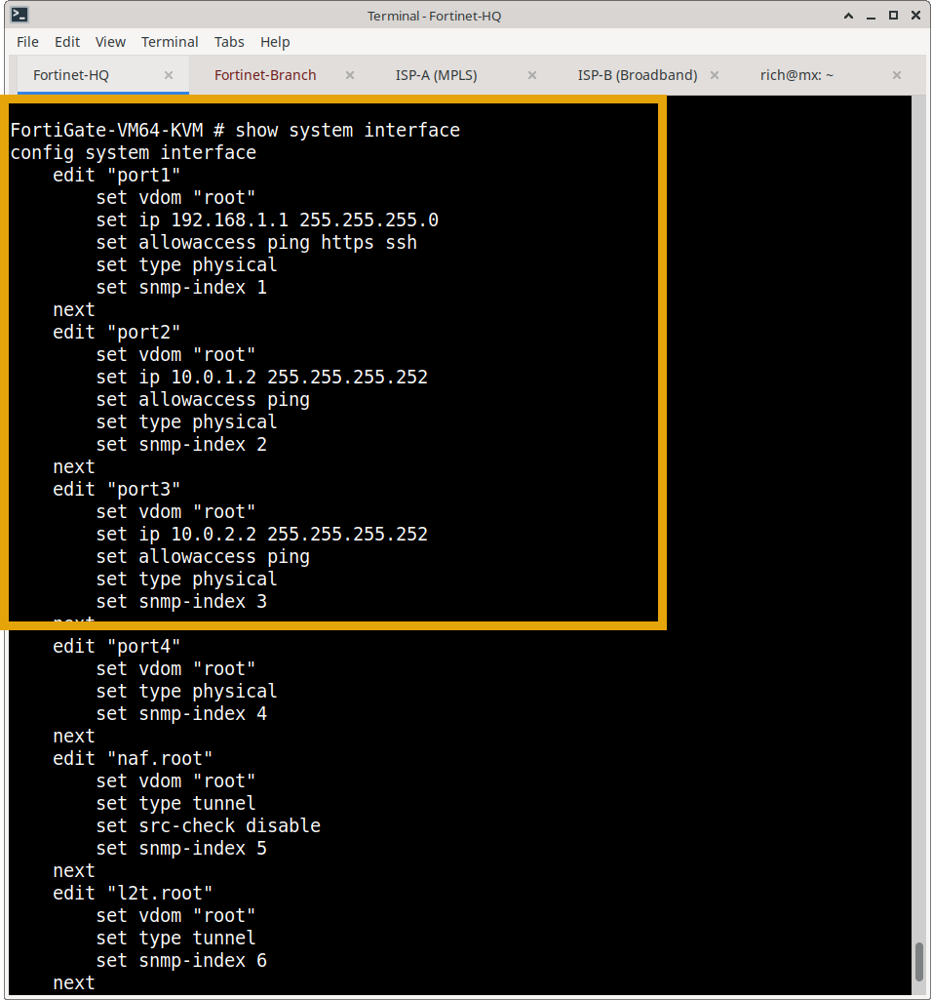

**Branch-Fortigate: show system interface**

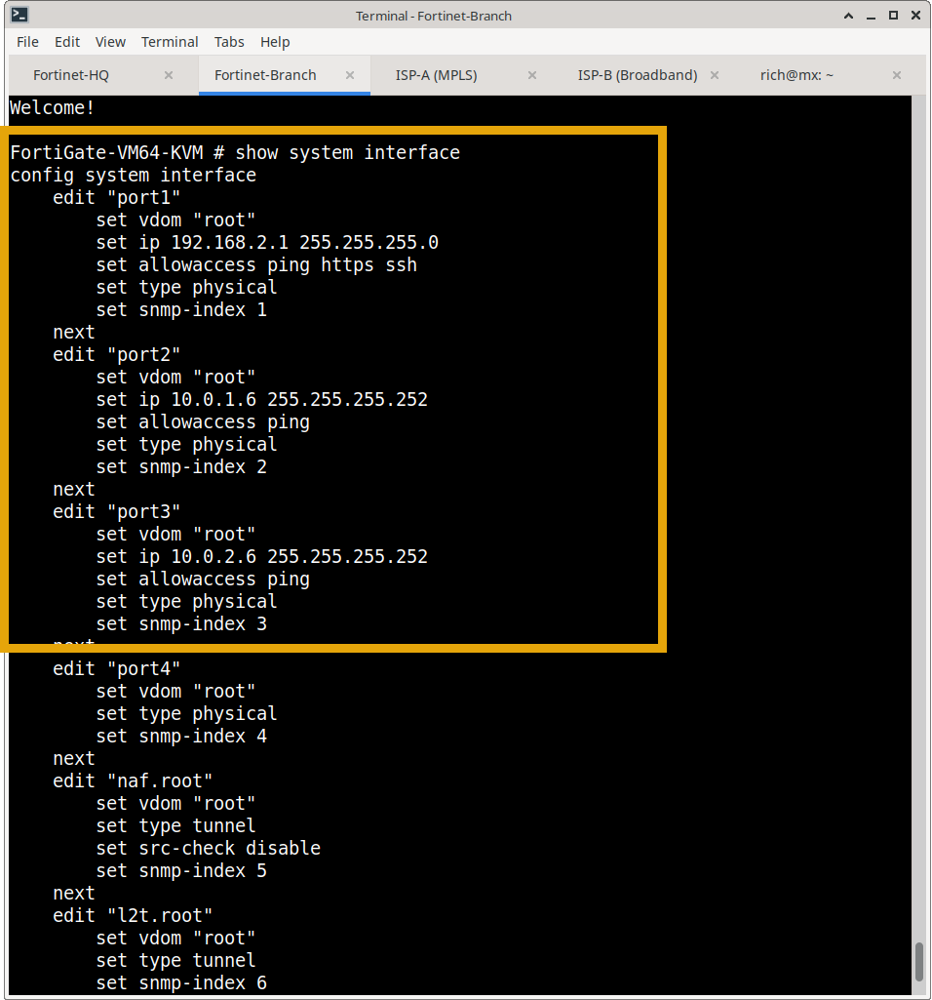

### SD-WAN Interfaces 

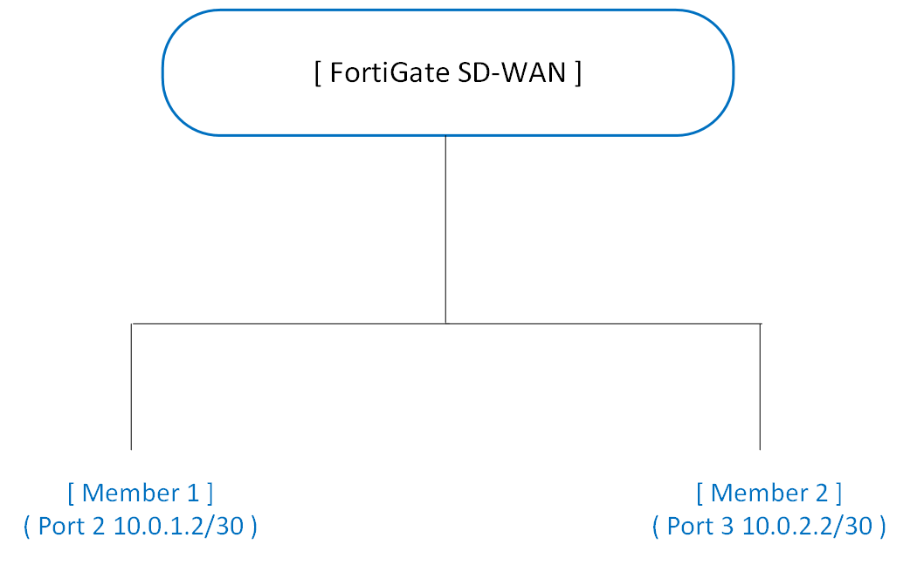

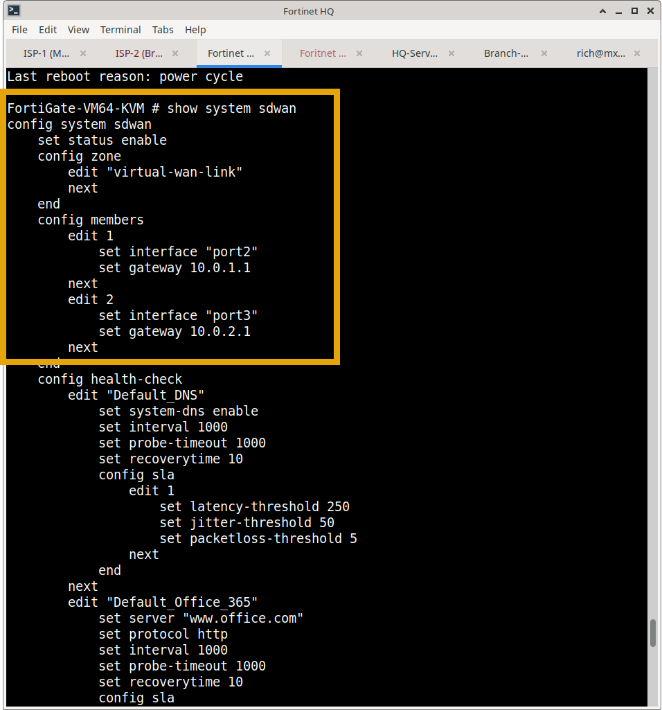

---

## Configuration & Engineering Logic

### 1. Dedicated Underlay Health Monitors
To prevent false-positive link fails caused by transient Internet-wide outages, dedicated link-level monitors probe the **immediate provider next-hop** of each physical interface:
* **`ISP_A_Monitor`**: Sends ICMP probes out `port2` targeting `10.0.1.1`.
* **`ISP_B_Monitor`**: Sends ICMP probes out `port3` targeting `10.0.2.1`.

```fortios
config system sdwan
    config health-check
        edit "ISP_A_Monitor"
            set server "10.0.1.1"
            set protocol ping
            set members 1
            set interval 500
            set failtime 3
            set recoverytime 3
        next
        edit "ISP_B_Monitor"
            set server "10.0.2.1"
            set protocol ping
            set members 2
            set interval 500
            set failtime 3
            set recoverytime 3
        next
    end
end
```
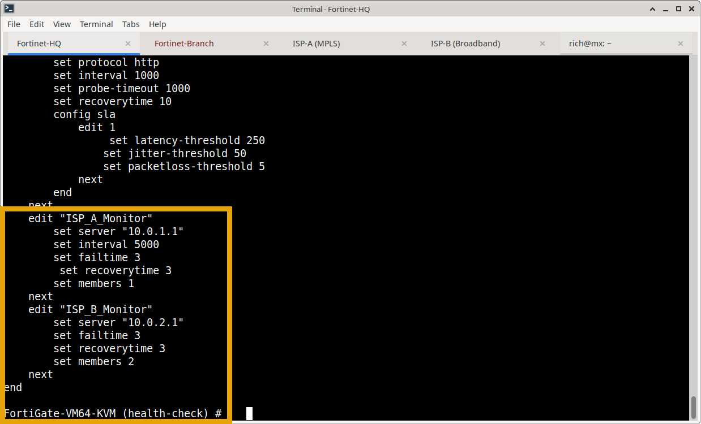

### 2. SD-WAN Service Rule (Priority Steering)
* **Steering Strategy:** `mode priority` (Active/Standby).
* **Preference Hierarchy:** Member 1 (`port2` - MPLS) > Member 2 (`port3` - Broadband).
* **Failover Logic:** As long as `ISP_A_Monitor` passes its health-check, all traffic to `Branch-Subnet` (`192.168.2.0/24`) is pinned to `port2`. If `ISP_A_Monitor` fails 3 consecutive intervals, the service rule immediately selects Member 2 (`port3`).

```fortios
config system sdwan
    config service
        edit 1
            set name "HQ-to-Branch"
            set mode priority
            set dst "Branch-Subnet"
            set src "all"
            set health-check "ISP_A_Monitor" "ISP_B_Monitor"
            set priority-members 1 2
            set status enable
            set default enable
        next
    end
end
```
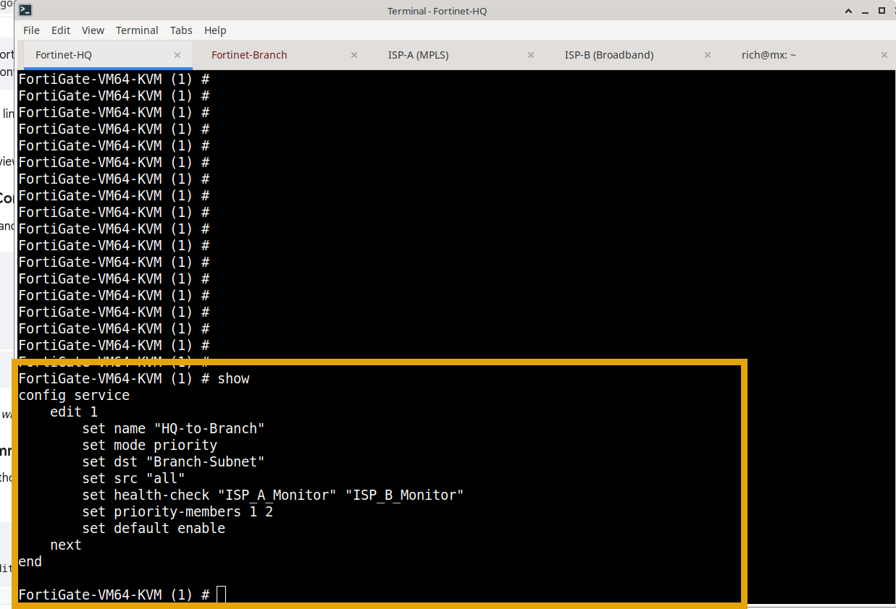

### 3. Static Routing Integration
```fortios
config router static
    edit 1
        set distance 1
        set sdwan-zone "virtual-wan-link"
    next
    edit 2
        set dst 192.168.2.0 255.255.255.0
        set distance 1
        set sdwan-zone "virtual-wan-link"
    next
end
```
*Edit 1 is the default route* 

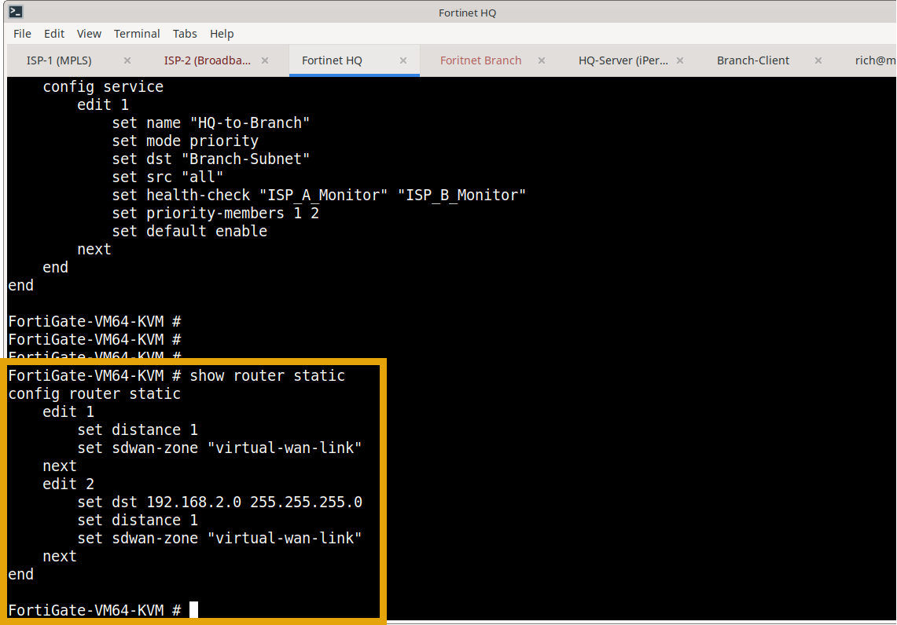

---

## Test Execution & Verification 

### Phase 1: Baseline Verification (Primary Path Healthy)
**Objective:** Confirm both underlay links are passing health checks and outbound traffic exits through `port2` (ISP-A MPLS).

1. **Verify SD-WAN Health-Check Quality:**
   ```text
   FortiGate-VM64-KVM # diagnose sys sdwan health-check
   Health Check(ISP_A_Monitor):
   Seq(1 port2): state(alive), packet-loss(0.000%) latency(8.663), jitter(2.876)
   Health Check(ISP_B_Monitor):
   Seq(2 port3): state(alive), packet-loss(0.000%) latency(10.048), jitter(1.689)
   ```
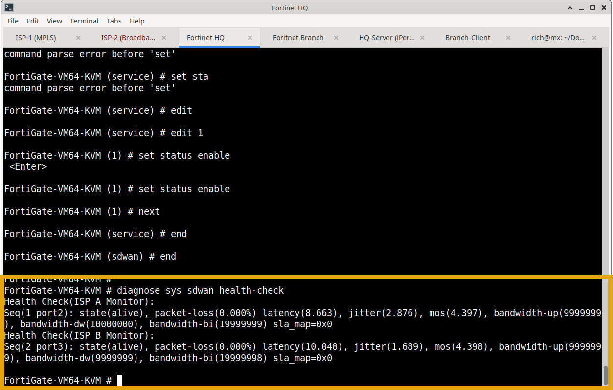

2. **Verify Active Member Steering:**
   ```text
   FortiGate-VM64-KVM # diagnose sys sdwan member
   Member(1): interface: port2, flags=0x0 , gateway: 10.0.1.1, priority: 1 1024, weight: 0
   Member(2): interface: port3, flags=0x0 , gateway: 10.0.2.1, priority: 1 1024, weight: 0
   ```
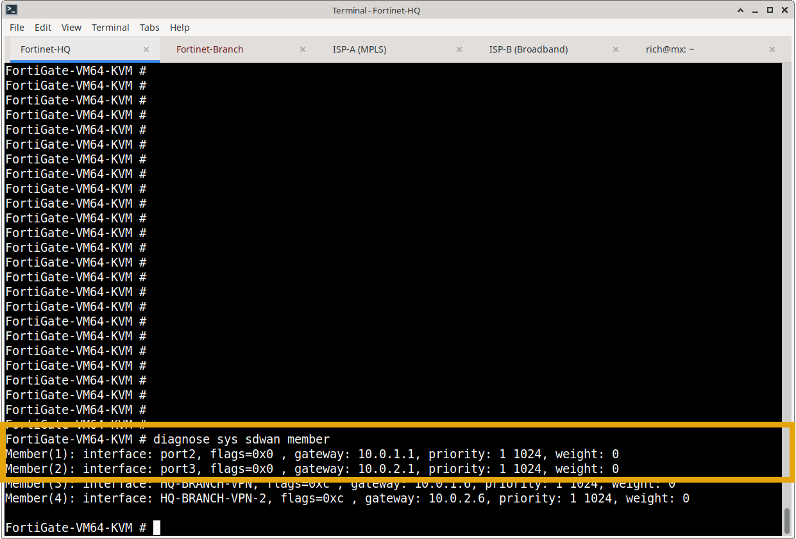

3. **Verify Baseline Traceroute (HQ Server -> Branch Client):**
   ```bash
   localhost:~# traceroute 192.168.2.10
   traceroute to 192.168.2.10 (192.168.2.10), 30 hops max, 46 byte packets
    1  192.168.1.1 (192.168.1.1)    2.863 ms
    2  10.0.1.1    (10.0.1.1)      12.805 ms   ISP-A (MPLS)
    3  10.0.1.6    (10.0.1.6)      15.393 ms   
    4  192.168.2.10 (192.168.2.10) 14.918 ms
   ```
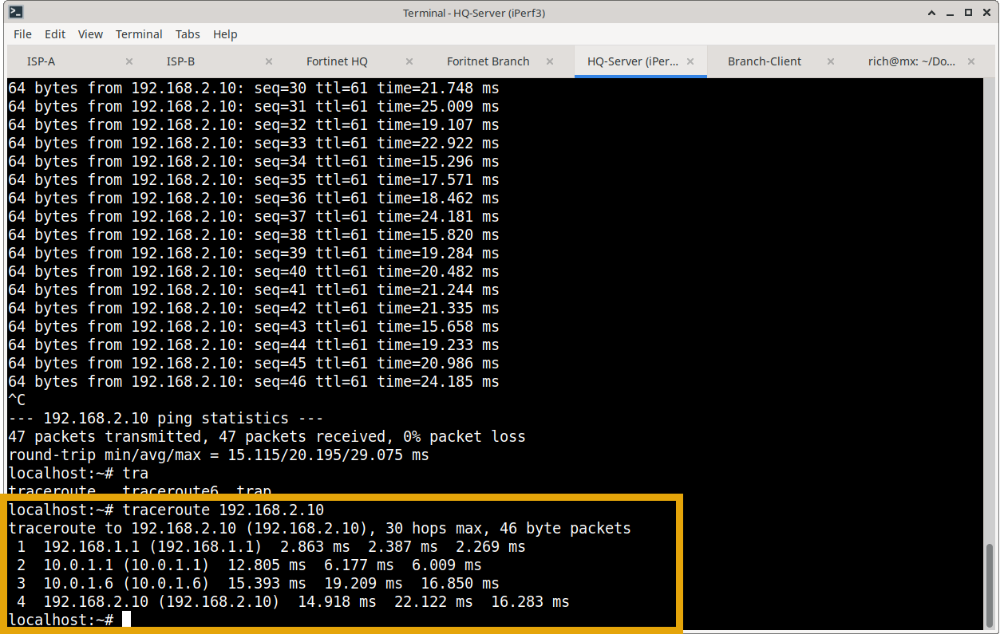


4. **SD-WAN Service 1 Baseline:**
   ```text
   FortiGate-VM64-KVM # diagnose sys sdwan service 1

   Service(1): Address Mode(IPV4) flags=0x240 use-shortcut-sla
   Tie break: cfg
   Gen(209), TOS(0x0/0x0), Protocol(0: 1->65535), Mode(priority), link-cost-factor(latency), link-cost-threshold(10), heath-check(ISP_A_Monitor ISP_B_Monitor)
   Members(2):
     1: Seq_num(1 port2), alive, latency: 9.259, selected
     2: Seq_num(2 port3), alive, latency: 10.149, selected
   Src address(1):
           0.0.0.0-255.255.255.255

   Dst address(1):
           192.168.2.0-192.168.2.255

   FortiGate-VM64-KVM #
   ```
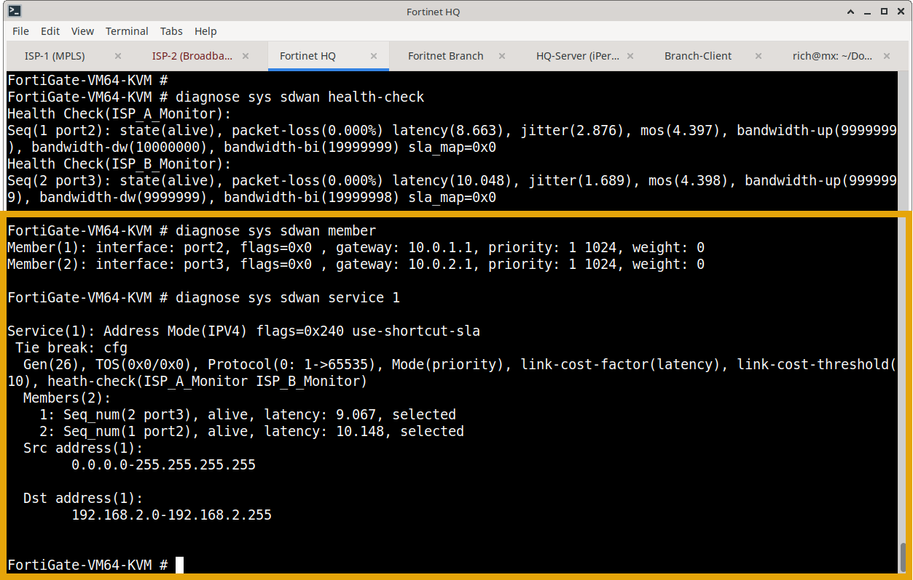

---

### Phase 2: Simulating Failure (Upstream ACL)
**Objective:** Simulate an underlay ISP failure without physical interface down-state by denying FortiGate probe packets on `ISP-1-MPLS`.

```cisco
ISP-1-MPLS(config)# ip access-list extended BLOCK-SDWAN-PROBE
ISP-1-MPLS(config-ext-nacl)# 10 deny icmp host 10.0.1.2 host 10.0.1.1 echo
ISP-1-MPLS(config-ext-nacl)# 20 permit ip any any
ISP-1-MPLS(config-ext-nacl)# exit
ISP-1-MPLS(config)# interface FastEthernet0/0
ISP-1-MPLS(config-if)# ip access-group BLOCK-SDWAN-PROBE in
```
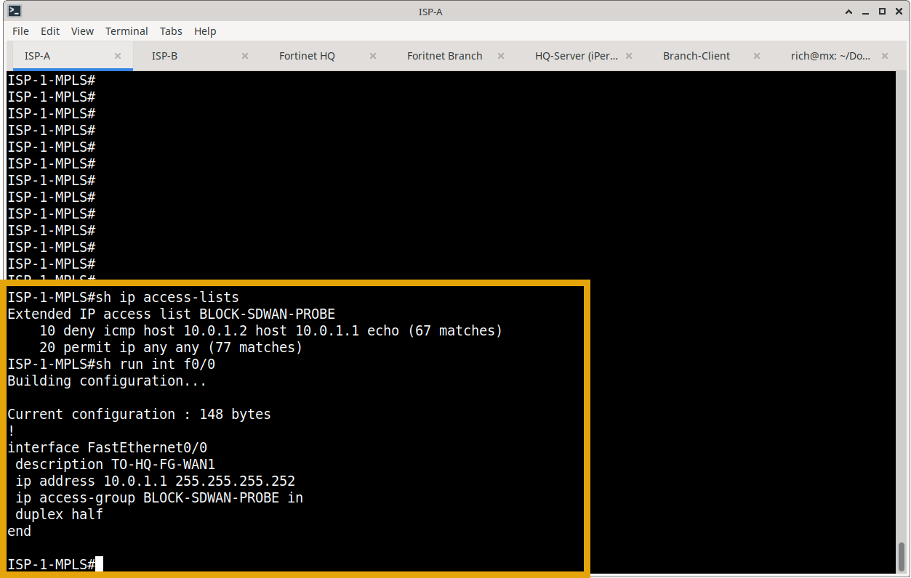

* **Physical State Check:** `FastEthernet0/0` stays **UP / UP**, proving traditional static routing with interface-tracking would fail to detect this failure.

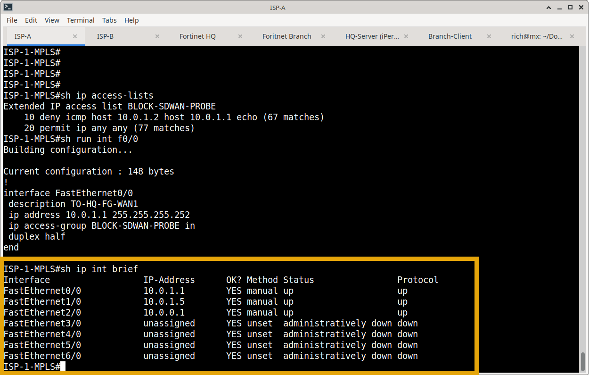

* **SD-WAN Service Re-Evaluation:**
  ```text
  FortiGate-VM64-KVM # diagnose sys sdwan service
  Service(1): Address Mode(IPV4) flags=0x240 use-shortcut-sla
  Tie break: cfg
  Gen(62), Mode(priority), health-check(ISP_A_Monitor ISP_B_Monitor)
  Members(2):
    1: Seq_num(2 port3), alive, latency: 8.960, selected  <-- PROMOTED TO ACTIVE
    2: Seq_num(1 port2), dead                             <-- FLAGGED DEAD
  ```
  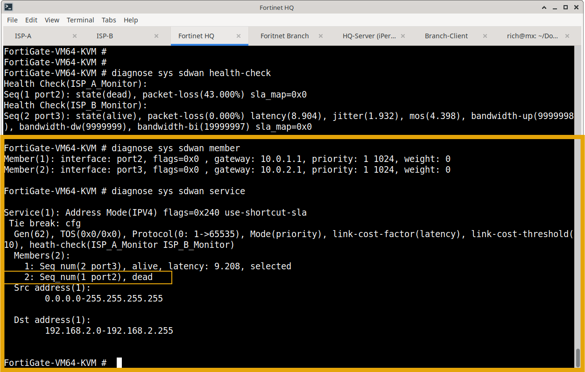
  
* **SD-WAN Health Check Re-Evaluation:**
 ```text
FortiGate-VM64-KVM # diagnose sys sdwan health-check
Health Check(ISP_A_Monitor):
Seq(1 port2): state(dead), packet-loss(43.000%) sla_map=0x0
Health Check(ISP_B_Monitor):
Seq(2 port3): state(alive), packet-loss(0.000%) latency(8.904), jitter(1.932), mos(4.398), bandwidth-up(9999998), bandwidth-dw(9999999), bandwidth-bi(19999997) sla_map=0x0
  ```
 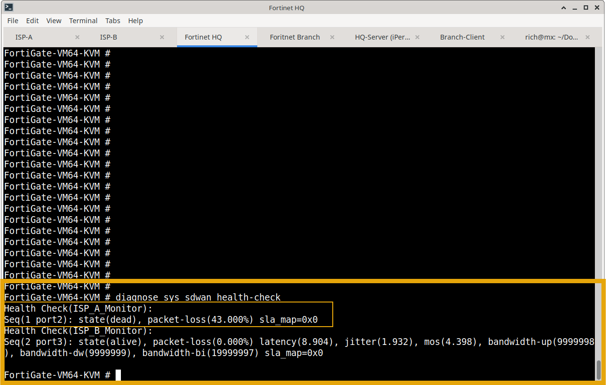
  
---

### Phase 3: Traffic Failover & Data Plane Continuity
**Objective:** Confirm active data plane re-route and packet loss during failover.

1. **Traceroute via Backup Path (ISP-B Broadband):**
   ```bash
   localhost:~# traceroute 192.168.2.10
   traceroute to 192.168.2.10 (192.168.2.10), 30 hops max, 46 byte packets
    1  192.168.1.1 (192.168.1.1)    2.628 ms
    2  10.0.2.1    (10.0.2.1)      17.510 ms   Shifted to ISP-B (Broadband)
    3  10.0.2.6    (10.0.2.6)      24.376 ms   Branch WAN2 Interface
    4  192.168.2.10 (192.168.2.10) 24.905 ms
   ```
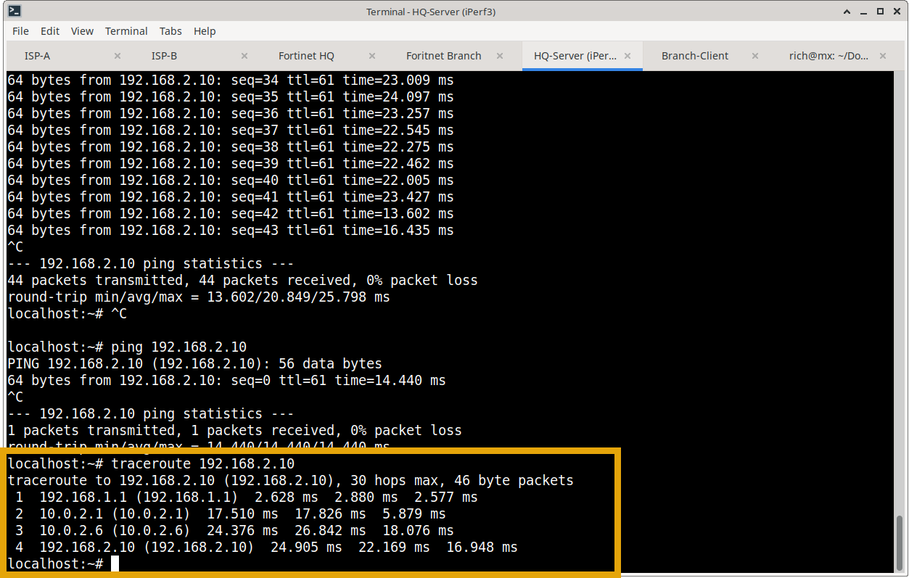

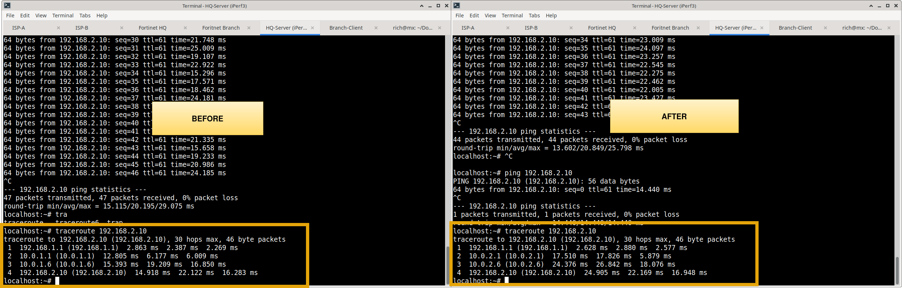
	
2. **Continuous ICMP Stream Analysis:**
   Continuous ICMP pings remained uninterrupted across the transition with sub-second failover (0% packet drop observed once next-hop reconverged).

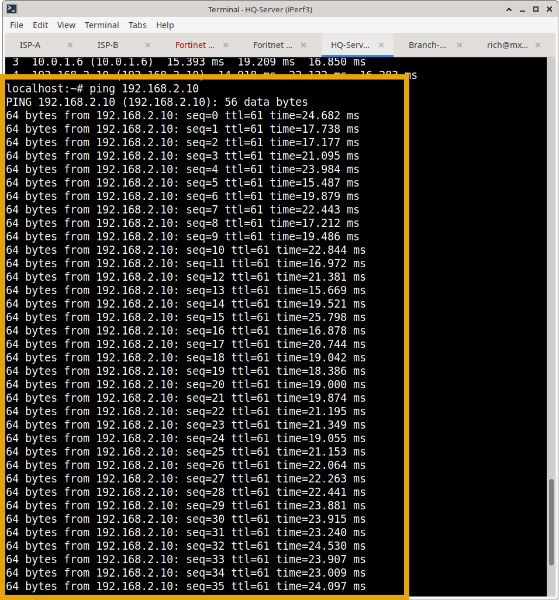

---

### Phase 4: Recovery (Restoration of Preferred Path)
**Objective:** Remove the ACL blackhole on `ISP-1-MPLS` and observe automatic failback.

1. **Remove ACL on ISP Router:**
   ```cisco
   ISP-1-MPLS(config)# interface FastEthernet0/0
   ISP-1-MPLS(config-if)# no ip access-group BLOCK-SDWAN-PROBE in
   ```
   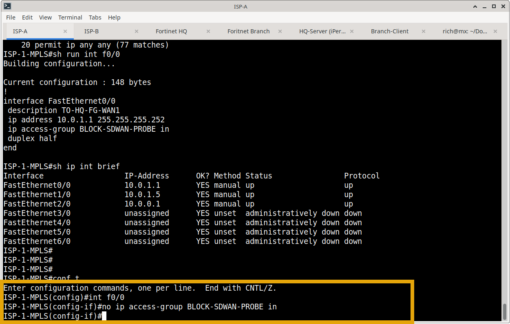

2. **SD-WAN Service Re-selection:**
   ```text
   FortiGate-VM64-KVM # diagnose sys sdwan service
   Service(1): Address Mode(IPV4) flags=0x240 use-shortcut-sla
   Tie break: cfg
   Gen(63), Mode(priority), health-check(ISP_A_Monitor ISP_B_Monitor)
   Members(2):
     1: Seq_num(1 port2), alive, latency: 10.055, selected  <-- RESTORED PRIMARY
     2: Seq_num(2 port3), alive, latency: 9.521, selected
   ```
   *Traffic immediately preempts back to Priority 1 (`port2`) cleanly.*

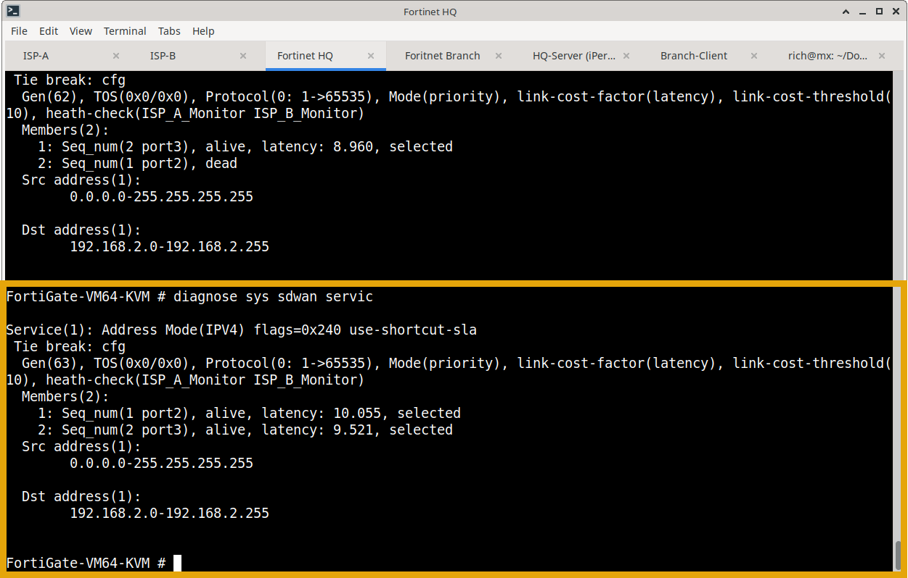

---

Here is the updated **Evidence Index** mapped to the exact file names from your directory tree:

---

## Evidence Index

| Phase | Artifact / Screenshot | Purpose & Verification |
| :--- | :--- | :--- |
| **Phase 1: Baseline** | `show-system-sd-wan.png` | Confirms SD-WAN zone configuration, member mappings, and probe timers. |
| **Phase 1: Baseline** | `show-system-interface-hq.png` | Confirms physical interface IP addressing, VDOM, and management access on HQ FortiGate. |
| **Phase 1: Baseline** | `show-system-interface-branch.png` | Confirms WAN/LAN physical interface IP addressing on Branch FortiGate. |
| **Phase 1: Baseline** | `config-router-static.png` | Validates static route configuration bound to the `virtual-wan-link` SD-WAN zone. |
| **Phase 1: Baseline** | `health-check-show.png` | Displays CLI definition for underlay monitors (`ISP_A_Monitor` and `ISP_B_Monitor`). |
| **Phase 1: Baseline** | `isp-health-check-service.png` | Confirms SD-WAN service rule 1 (`HQ-to-Branch`) in `mode priority` with members 1 & 2. |
| **Phase 1: Baseline** | `diagnose-sd-wan-member-baseline.png` | Validates initial member states, gateways (`10.0.1.1` / `10.0.2.1`), and priority metrics. |
| **Phase 1: Baseline** | `diagnose-health-check-baseline.png` | Confirms healthy SLA metrics (0% packet loss, baseline latency/jitter) across both links. |
| **Phase 1: Baseline** | `traceroute-baseline.png` | Proves baseline egress traffic routes via `10.0.1.1` (`ISP-A` MPLS). |
| **Phase 2: Link Failure** | `isp-a-intentional-failure-acl.png` | Displays Cisco ACL `BLOCK-SDWAN-PROBE` applied inbound on `ISP-1-MPLS` (`f0/0`). |
| **Phase 2: Link Failure** | `isp-a-port-remains-up.png` | Proves physical link remains `up/up`, proving carrier-detect cannot catch silent brownouts. |
| **Phase 2: Link Failure** | `health-check-during-failure.png` | Shows FortiGate detecting probe loss and transitioning `ISP_A_Monitor` to `state(dead)`. |
| **Phase 2: Link Failure** | `diagnose-sd-wan-service-during-failure.png` | Confirms rule re-evaluation: `port2` marked dead and `port3` promoted to active. |
| **Phase 3: Impact** | `traceroute-during-failure.png` | Proves active data plane reroute through `10.0.2.1` (`ISP-B` Broadband). |
| **Phase 3: Impact** | `continuous-ping.png` | Proves continuous packet flow and business continuity during failover. |
| **Phase 3: Impact** | `sd-wan-test.mp4` | Live screen capture of ACL failure injection, rapid steering, and sub-second failover. |
| **Phase 4: Recovery** | `isp-a-removing-acl.png` | Confirms removal of blocking ACL (`no ip access-group`) on provider router. |
| **Phase 4: Recovery** | `recovery-diagnose-sd-wan-service.png` | Shows automatic preemption back to Member 1 (`port2` - Priority 1) once health recovers. |
| **Phase 4: Recovery** | `diagnose-service-1.png` | Detailed post-recovery diagnostics confirming stable service rule operations. |


---

## Business Value Delivered
* **Autonomous High Availability:** Eliminates SLA penalties by automatically rerouting branch traffic around silent upstream ISP brownouts without operational intervention.
* **Carrier Cost Optimization:** Enables secure, cost-effective broadband links to serve as hot-standbys for expensive MPLS circuits.
* **Preserved User Experience:** Convergence occurs fast enough that real-time TCP applications (RDP, ERP, CRM) survive transient WAN failures without reconnecting.

---

### ️ What's Next?

With foundational underlay health monitoring and link-state failover fully validated, the next step is to evolve from IP-based routing to **Application-Aware Routing**. 

Continue to the next task to explore dynamic traffic steering:
- **[Task 2: Application-Aware Routing & Dynamic SaaS Steering (FQDN)](../Policy%202%20Application-Aware/)** – Utilizing FQDN address objects to dynamically steer critical SaaS traffic over optimal WAN paths based on domain names rather than static IPs.
