# Task 2: Application-Aware Routing & Dynamic SaaS Steering (FQDN)

## Executive Summary
Modern enterprise SaaS applications (e.g., Microsoft 365, Salesforce, AWS workspaces) rely on dynamic public IP pools and Content Delivery Networks (CDNs), making static IP whitelisting impractical and high maintenance. 

This module implements **Application-Aware Routing** on Fortinet FortiOS SD-WAN using **FQDN (Fully Qualified Domain Name) Address Objects** combined with **SD-WAN Service Rules**. The FortiGate continuously resolves and caches the IP addresses associated with critical business domains and dynamically programs kernel policy routes (`proute`) to steer latency-sensitive SaaS traffic over the dedicated MPLS link (`ISP-A` / `port2`). 

The implementation was subsequently validated by intentionally modifying the rule priority to dynamically reroute traffic across the secondary Broadband circuit (`ISP-B` / `port3`), confirming deterministic steering and agile traffic engineering.

**Live Execution: Please enlarger for clearer video**

---

## Lab Architecture & IP Addressing


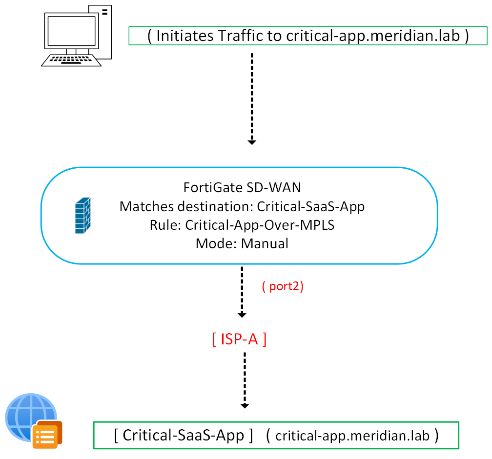

| Device / Host | Interface | IP Address | Subnet Mask | Description / Role |
| :--- | :--- | :--- | :--- | :--- |
| **FortiGate HQ** | `port1` | `192.168.1.1` | `255.255.255.0` | LAN Gateway |
| **FortiGate HQ** | `port2` | `10.0.1.2` | `255.255.255.252` | WAN1 -> Primary MPLS (`ISP-A`) |
| **FortiGate HQ** | `port3` | `10.0.2.2` | `255.255.255.252` | WAN2 -> Secondary Broadband (`ISP-B`) |
| **ISP-1-MPLS** | `Fa0/0`, `Fa3/0` | `10.0.1.1`, `10.0.3.1` | `255.255.255.252` | MPLS Provider Core Router |
| **ISP-2-BB** | `Fa0/0`, `Fa2/0` | `10.0.2.1`, `10.0.0.2` | `255.255.255.252` | Broadband Provider Router |
| **HQ Server** | `eth0` | `192.168.1.10` | `255.255.255.0` | Test Client Initiating SaaS Traffic |
| **Alpine DNS Server** | `eth0` | `192.168.60.11` | `255.255.255.0` | Authoritative DNS (`critical-app.meridian.lab`) |
| **Alpine Web Server** | `eth0` | `192.168.60.10` | `255.255.255.0` | Simulated Critical SaaS Application (HTTP:8080) |

**Web Server IP**

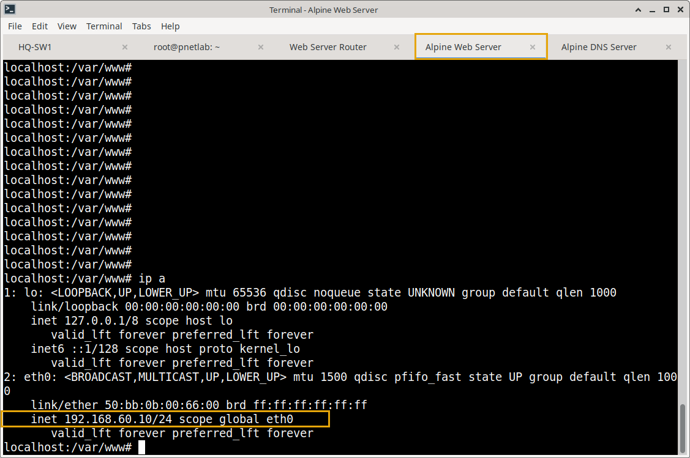

**DNS Service IP**

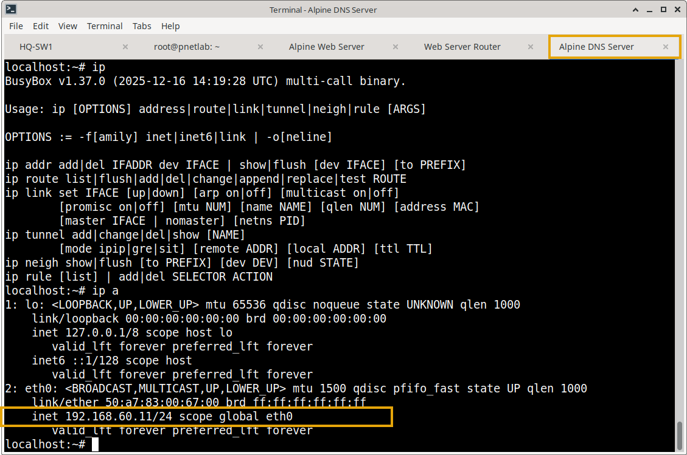

---

## Configuration & Engineering Logic

### 1. FQDN Object Definition & Cache Tuning
An FQDN object is configured on FortiGate targeting `critical-app.meridian.lab`. The `cache-ttl` is explicitly set to `30` seconds. This forces the FortiGate DNS proxy daemon to refresh resolution records frequently, ensuring fast convergence if cloud providers update their IP pools.

```fortios
config firewall address
    edit "Critical-SaaS-App"
        set type fqdn
        set fqdn "critical-app.meridian.lab"
        set cache-ttl 30
    next
end

config system dns
    set primary 192.168.60.11
    set secondary 8.8.4.4
end
```
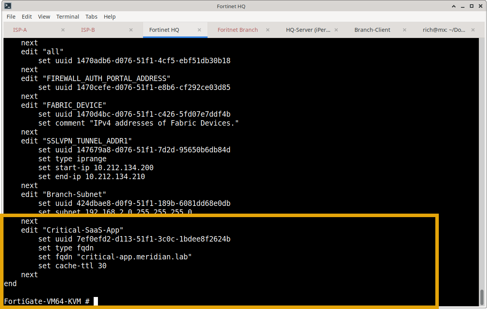

### 2. SD-WAN Service Rule 2 (Application Steering)
A dedicated SD-WAN service rule (`edit 2`) matches destination traffic matching the FQDN address object and pins it to **Member 1 (`port2` - MPLS)** in `manual` mode.

```fortios
config system sdwan
    config service
        edit 2
            set name "Critical-App-Over-MPLS"
            set mode manual
            set dst "Critical-SaaS-App"
            set priority-members 1
        next
    end
end
```
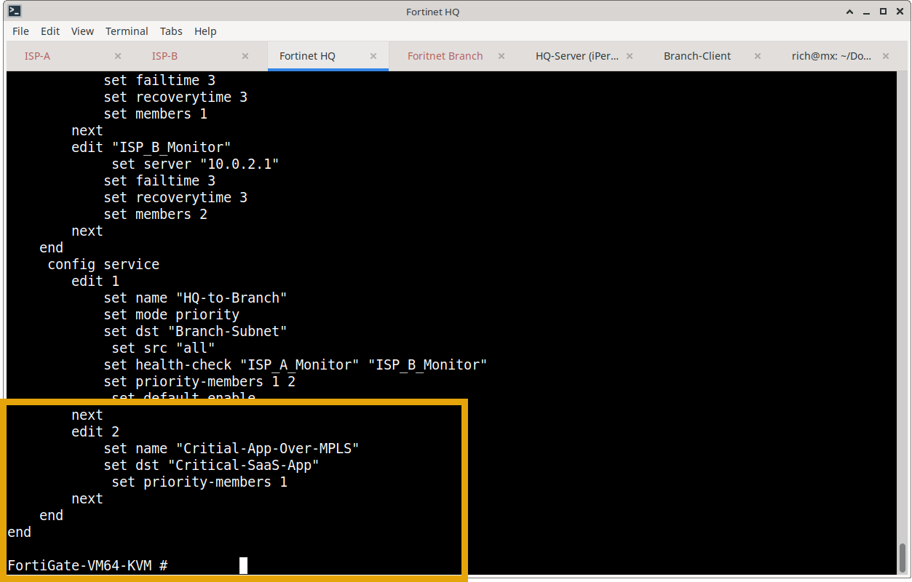

---

## Verification & Execution 

### Phase 1: DNS Resolution & FQDN Cache Verification
1. **Authoritative Resolution Verification (DNS Server):**
   ```text
   localhost:~# nslookup critical-app.meridian.lab 127.0.0.1
   Server:    127.0.0.1
   Address:   127.0.0.1:53

   Name:      critical-app.meridian.lab
   Address:   192.168.60.11
   ```
   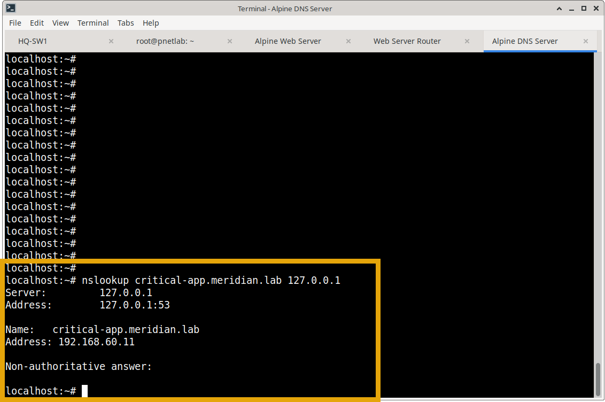

2. **FortiGate DNS Proxy Cache Inspection (dnsproxy 6):**
   ```text
   FortiGate-VM64-KVM # diagnose test application dnsproxy 6
   worker idx: 0
   ...
   vfid=0 name=critical-app.meridian.lab ver=IPv4 timer running,  min_ttl=0:23, cache_ttl=30 , slot=-1, num=1, wildcard=0
           192.168.60.11 (ttl=0:0:0)
   ...
   FQDN num=7
   ```
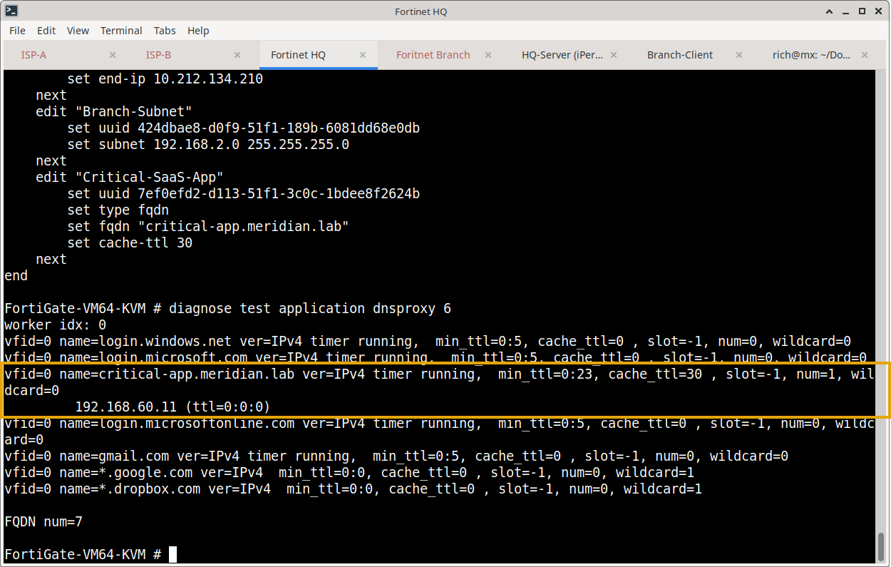

3. **Dynamic Policy Route (proute) Programming:**
   FortiOS translates the resolved FQDN into a dynamic policy route bound to outgoing interface `port2`:
   ```text
   FortiGate-VM64-KVM # diagnose firewall proute list
   list route policy info(vf=root):

   id=2131689474(0x7f0f0002) vwl_service=2(Critial-App-Over-MPLS) vwl_mbr_seq=1 dscp_tag=0xfc 0xfc flags=0x0 tos=0x00 tos_mask=0x00 protocol=0 sport=0-65535 iif=0 dport=1-65535 path(1) oif=4(port2)
   destination fqdn(1):
           critical-app.meridian.lab ID(229) ADDR(192.168.60.11)
   source wildcard(1): 0.0.0.0/0.0.0.0
   hit_count=4 last_used=2026-10-26 01:10:43
   ```
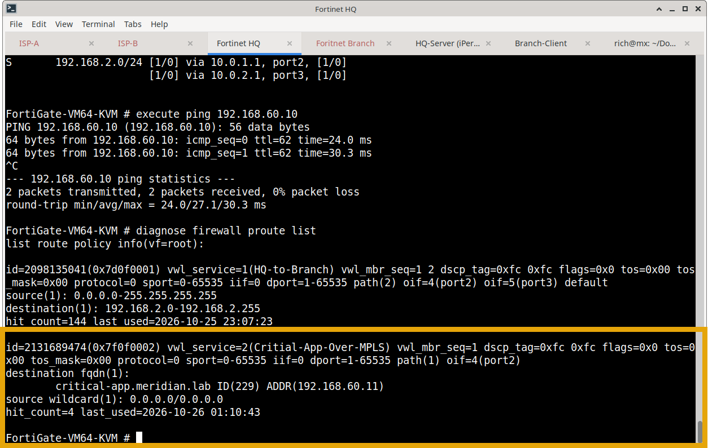

4. **SD-WAN Service Table Verification:**
   Verifies that both underlay members are active and that Service Rule 2 correctly binds the destination FQDN (`critical-app.meridian.lab`) to Member 1 (`port2` / MPLS):
   ```text
   FortiGate-VM64-KVM # diagnose sys sdwan service
   
   Service(2): Address Mode(IPV4) flags=0x200 use-shortcut-sla
   Tie break: cfg
   Gen(1), TOS(0x0/0x0), Protocol(0: 1->65535), Mode(manual)
   Members(1):
     1: Seq_num(1 port2), alive, selected
   Dst fqdn(1): critical-app.meridian.lab(229)

   FortiGate-VM64-KVM #
   ```
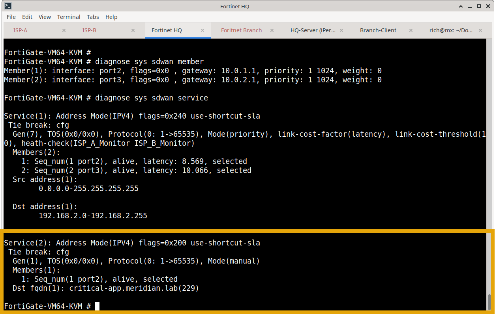

---

### Phase 2: Traffic Steering over Primary Path (MPLS)
1. **Client DNS Resolution from HQ Node:**
   ```text
   localhost:~# nslookup critical-app.meridian.lab
   Server:    192.168.60.11
   Address:   192.168.60.11:53

   Name:      critical-app.meridian.lab
   Address:   192.168.60.11
   ```
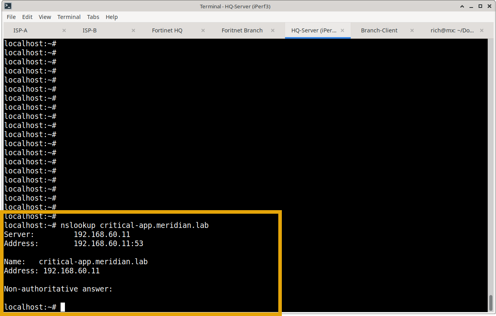

2. **Traceroute Validation (Egress via `port2` / `10.0.1.1`):**
   ```text
   localhost:~# traceroute -I critical-app.meridian.lab
   traceroute to critical-app.meridian.lab (192.168.60.11), 30 hops max, 46 byte packets
    1  192.168.1.1 (192.168.1.1)  2.718 ms  2.301 ms  2.458 ms
    2  10.0.1.1 (10.0.1.1)       16.860 ms 15.854 ms  6.240 ms   <-- MPLS (port2)
    3  10.0.3.2 (10.0.3.2)       14.347 ms 28.387 ms 16.031 ms
    4  critical-app.meridian.lab (192.168.60.11) 30.879 ms 32.862 ms 23.485 ms
   ```
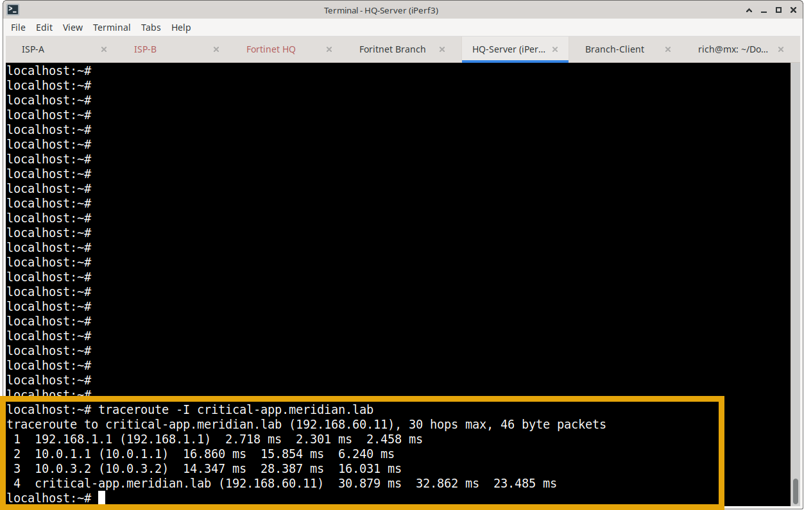

3. **Application Layer HTTP Request (wget):**
   ```text
   localhost:~# wget -S -O - http://192.168.60.10:8080/
   Connecting to 192.168.60.10:8080 (192.168.60.10:8080)
   HTTP/1.0 200 OK
   Server: SimpleHTTP/0.6 Python/3.12.15
   Content-Type: text/html
   Content-Length: 191

   <title>Meridian Critical Application</title>
   <h1>Meridian Critical Application</h1>
   <p>SD-WAN traffic steering test successful.</p>
   ``` 
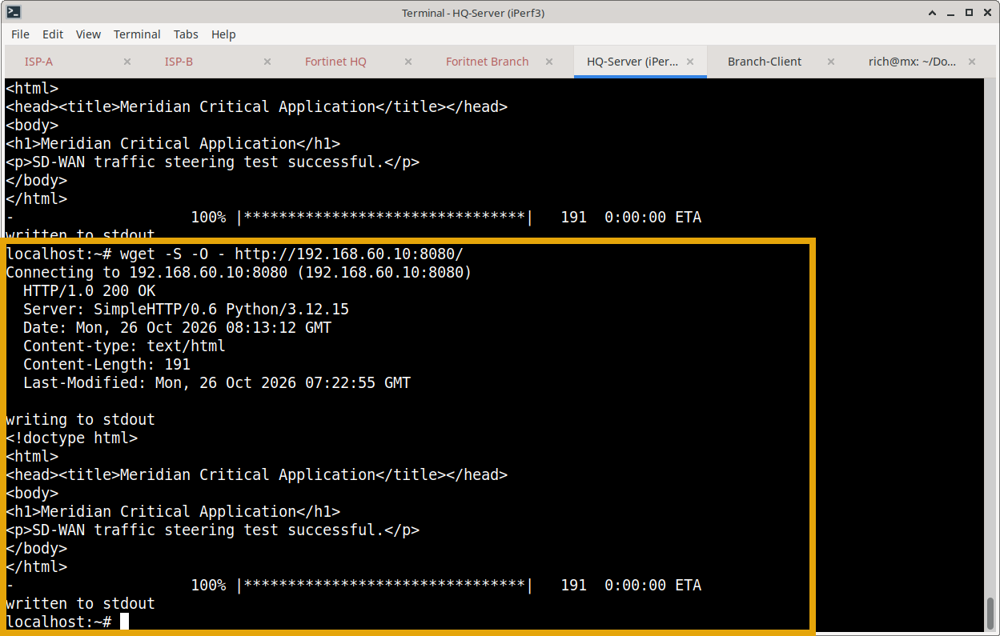

---

### Phase 3: Dynamic Steering Shift (Rerouting to Broadband)
To validate policy agility without interrupting the client stack, the SD-WAN service rule was modified to point to Member 2 (`port3` / Broadband):

```fortios
config system sdwan
    config service
        edit 2
            set priority-members 2
        next
    end
end
```
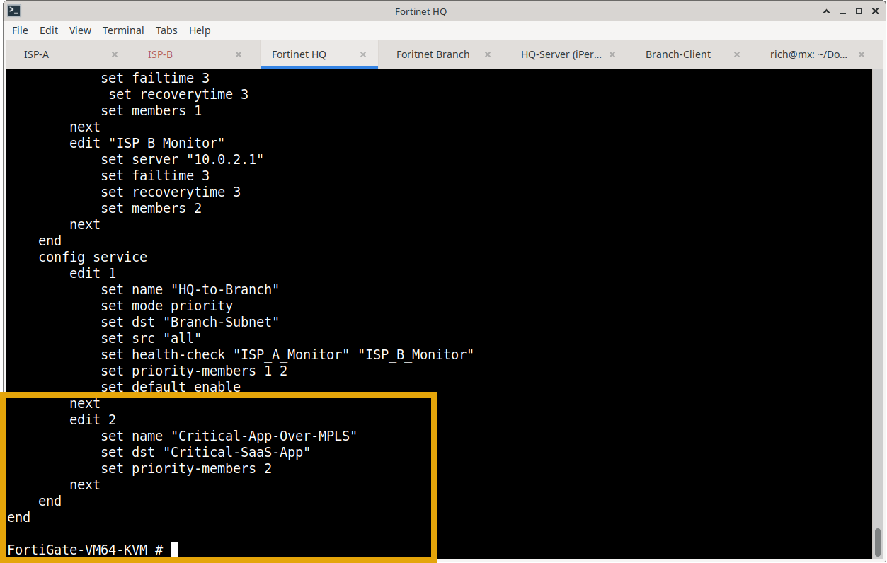

1. **Service Verification:**
   ```text
   FortiGate-VM64-KVM # diagnose sys sdwan service
   Service(2): Address Mode(IPV4) flags=0x200 use-shortcut-sla
   Tie break: cfg
   Gen(2), TOS(0x0/0x0), Protocol(0: 1->65535), Mode(manual)
   Members(1):
     1: Seq_num(2 port3), alive, selected
   Dst fqdn(1): critical-app.meridian.lab(229)
   ```
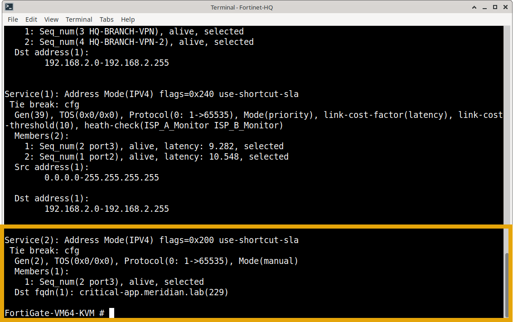

2. **Traceroute Post-Policy Update (Egress shifted to `port3` / `10.0.2.1`):**
   ```text
   localhost:~# traceroute -I critical-app.meridian.lab
   traceroute to critical-app.meridian.lab (192.168.60.11), 30 hops max, 46 byte packets
    1  192.168.1.1 (192.168.1.1)  1.693 ms  3.527 ms  3.232 ms
    2  10.0.2.1 (10.0.2.1)        7.538 ms 14.739 ms  4.311 ms   <-- Shifted to ISP-B (port3)
    3  10.0.0.1 (10.0.0.1)       31.913 ms 26.403 ms 22.608 ms
    4  10.0.3.2 (10.0.3.2)       48.028 ms 32.440 ms 25.807 ms
    5  critical-app.meridian.lab (192.168.60.11) 43.483 ms 36.554 ms 37.804 ms
   ```
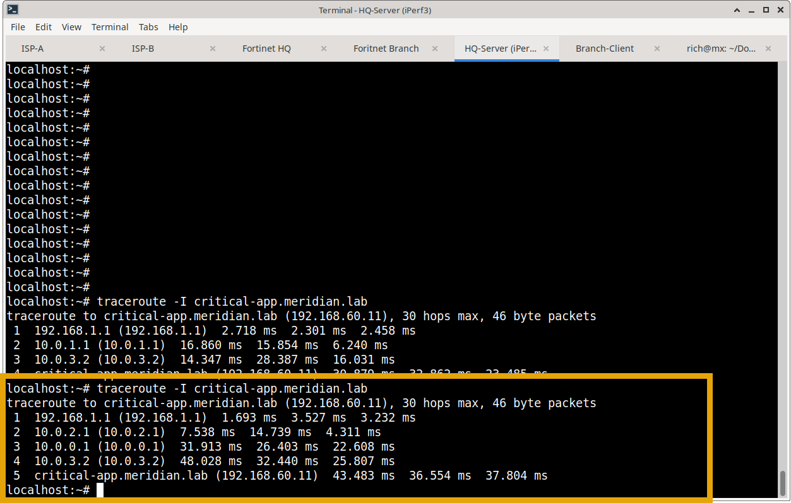

**ISP: show ip int brief**

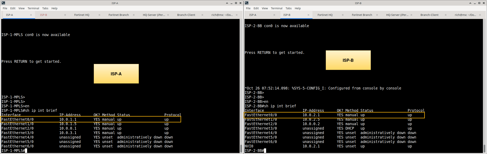

**Traceroute**

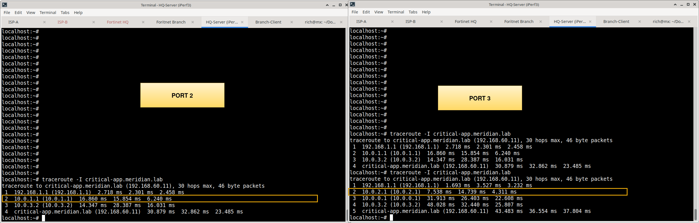

---

## Evidence Index

| Phase | Artifact / Screenshot | Purpose & Verification |
| :--- | :--- | :--- |
| **Phase 1: Baseline & Topology** | `screenshots/topology.png` | Network topology diagram showing HQ FortiGate, dual ISP underlays, DNS, and Web server. |
| **Phase 1: Baseline & Topology** | `screenshots/application-aware-visio.png` | Detailed Visio diagram illustrating the application-aware traffic flow and FQDN steering path. |
| **Phase 1: Baseline & Topology** | `screenshots/dns-server-ip.png` | IP configuration output (`ip a`) verifying Alpine DNS Server at `192.168.60.11/24`. |
| **Phase 1: Baseline & Topology** | `screenshots/web-server-ip.png` | IP configuration output (`ip a`) verifying Alpine Web Server hosting app at `192.168.60.10/24`. |
| **Phase 1: Baseline & Topology** | `screenshots/show-ip-int-brief-both-routers.png` | Confirms WAN interfaces on both provider routers (`ISP-1-MPLS` and `ISP-2-BB`) are UP/UP. |
| **Phase 1: Baseline & Topology** | `screenshots/nslookup-127.png` | Local loopback DNS query on DNS server proving authoritative resolution of `critical-app.meridian.lab`. |
| **Phase 2: Configuration & Resolution** | `screenshots/show-firewall-address.png` | Confirms FQDN address object `Critical-SaaS-App` configured with `cache-ttl 30`. |
| **Phase 2: Configuration & Resolution** | `screenshots/fortinet-dns-proxy.png` | FortiGate CLI (`diagnose test application dnsproxy 6`) showing cached resolution to `192.168.60.11`. |
| **Phase 2: Configuration & Resolution** | `screenshots/config-service-member-1.png` | SD-WAN service configuration showing Rule 2 pinned to Member 1 (`port2` / MPLS). |
| **Phase 2: Configuration & Resolution** | `screenshots/policy-route.png` | Verifies dynamic policy route (`diagnose firewall proute list`) programmed with `oif=port2`. |
| **Phase 2: Configuration & Resolution** | `screenshots/sd-wan-service-member-1.png` | Service table (`diagnose sys sdwan service`) verifying Rule 2 active with Member 1 selected. |
| **Phase 3: Traffic Steering Validation** | `screenshots/ns-lookup-hq.png` | End-host resolution test from HQ server resolving domain via internal DNS (`192.168.60.11`). |
| **Phase 3: Traffic Steering Validation** | `screenshots/traceroute-through-port-2.png` | Traceroute from HQ server confirming traffic egresses via `port2` (MPLS next-hop `10.0.1.1`). |
| **Phase 3: Traffic Steering Validation** | `screenshots/wget-successful.png` | Application layer HTTP test retrieving web payload from `192.168.60.10:8080`. |
| **Phase 4: Policy Change & Rerouting** | `screenshots/intentional-policy-change.png` | Administrative CLI configuration updating Rule 2 priority members from Member 1 to Member 2. |
| **Phase 4: Policy Change & Rerouting** | `screenshots/config-service-member-2.png` | SD-WAN service configuration verifying Rule 2 updated to `priority-members 2`. |
| **Phase 4: Policy Change & Rerouting** | `screenshots/sd-wan-service-member-2.png` | Service table confirming Rule 2 dynamically shifted and promoted Member 2 (`port3`) to active. |
| **Phase 4: Policy Change & Rerouting** | `screenshots/traceroute-port-3.png` | Traceroute from HQ server proving traffic immediately rerouted through `10.0.2.1` (`ISP-B`). |
| **Phase 4: Policy Change & Rerouting** | `screenshots/traceroute-before-after.png` | Side-by-side traceroute comparison demonstrating deterministic steering before and after the change. |

---

## Business Value Delivered
* **Zero Operational Overhead for Cloud IP Shifts:** Dynamic FQDN resolution eliminates manual subnet whitelisting when SaaS providers modify backend hosting IPs.
* **Granular SLA Assurance:** Ensures business-critical SaaS platforms (ERP, Office 365, internal web apps) are steered across high-quality MPLS circuits while non-critical bulk traffic stays on commodity broadband.
* **Deterministic Policy Enforcement:** Guarantees policy routing rules adapt synchronously as soon as users resolve application domain names.

---

### Next Module
* **[Task 3: Active/Active Load Balancing (Round-Robin)](../03-active-active-load-balancing/)** — Distributing outbound sessions across both WAN links simultaneously to maximize aggregate bandwidth utilization.
