# Task 3: Active/Active Load Balancing & Multi-Session Distribution

## Executive Summary
This module transitions the SD-WAN topology from an Active/Standby steering architecture into an **Active/Active Load Balancing** fabric. Rather than leaving secondary WAN circuits idle as dormant failovers, FortiOS distributes active sessions across both the MPLS link (ISP-A/ port2) and the Broadband link (ISP-B/port3) simultaneously.

This engineering validation explores the underlying session distribution algorithms in FortiOS (mode load-balance). It demonstrates why naive single-stream tests fail to engage multiple links due to flow-based hashing, proves how **Source-Destination IP hashing** splits concurrent streams across diverse underlays, and verifies **Round-Robin** per-session distribution.

**Round Robin SD-WAN Load Balancing: Please enlarge for clearer video**

https://github.com/user-attachments/assets/c712f2bf-b5b2-4d1c-8195-2a56a72166f7

**Source-Destination SD-WAN Load Balancing: Please enlarge for clearer video (single stream)**

https://github.com/user-attachments/assets/80330c6c-9eee-4862-8f14-cb77a0d21306

**Source-Destination SD-WAN Load Balancing: Please enlarge for clearer video (double stream)**

https://github.com/user-attachments/assets/51b3ce9c-2db1-43a6-8795-dfb4797149be

---

## Lab Architecture & Multi-Stream Testbed

To generate distinct 5-tuple flows and validate concurrent dual-link utilization without NAT collisions, multiple dedicated host endpoints were provisioned across both the HQ and Branch sites.

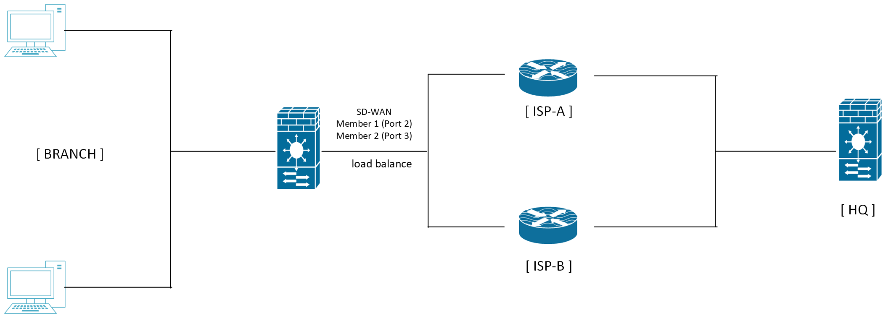

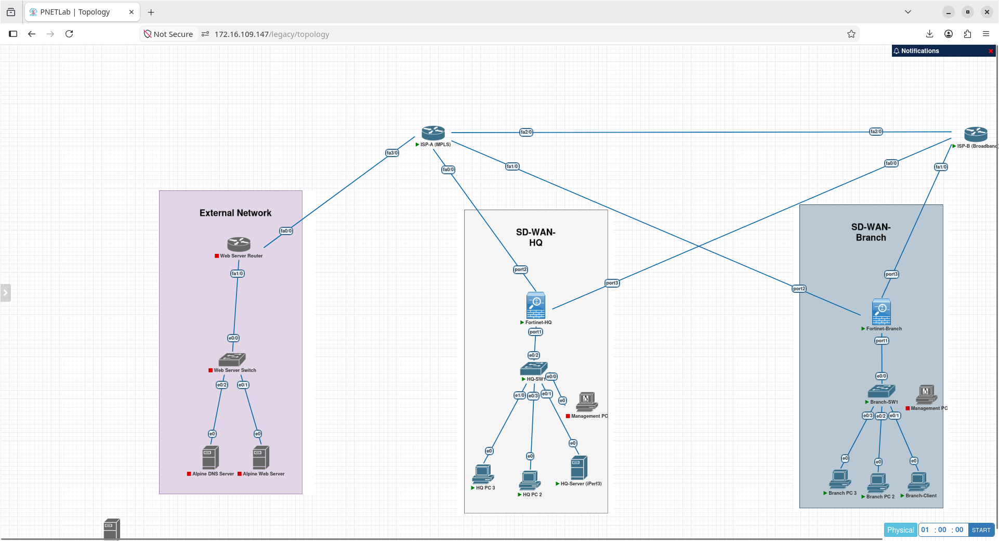


### Addressing & Endpoint Roles
| Device | Interface | IP Address | Subnet Mask | Role / Function |
| :--- | :--- | :--- | :--- | :--- |
| **Branch FortiGate** | `port1` / `port2` / `port3` | `192.168.2.1` / `10.0.1.6` / `10.0.2.6` | `/24`, `/30`, `/30` | Edge SD-WAN Gateway (Traffic Generator) |
| **HQ FortiGate** | `port1` / `port2` / `port3` | `192.168.1.1` / `10.0.1.2` / `10.0.2.2` | `/24`, `/30`, `/30` | Core SD-WAN Hub |
| **HQ Server 1** | `eth0` | `192.168.1.10` | `255.255.255.0` | Primary iPerf3 Server (`port 5201`) |
| **HQ PC 2** | `eth0` | `192.168.1.15` | `255.255.255.0` | Secondary iPerf3 Server (`port 5201`) |
| **HQ PC 3** | `eth0` | `192.168.1.20` | `255.255.255.0` | Tertiary iPerf3 Server (`port 5201`) |
| **Branch Client 1** | `eth0` | `192.168.2.10` | `255.255.255.0` | iPerf3 Client Stream A |
| **Branch PC 2** | `eth0` | `192.168.2.15` | `255.255.255.0` | iPerf3 Client Stream B |

---

### Hash Mode Algorithms Compared
Inside `config system sdwan` -> `config service` -> `set mode load-balance`:
* **set hash-mode source-dest-ip-based**: Computes an XOR/modulo hash combining Source IP and Destination IP. When multiple source endpoints target multiple destination endpoints, sessions are distributed across all active SLA-compliant members.
* **set hash-mode round-robin**: Alternates incoming new sessions sequentially across each healthy priority member regardless of IP entropy, ensuring predictable balancing in virtualized or low-client environments.

---

## Configuration & Policy Definition

### 1. Destination Address Objects & Group
```fortios
config firewall address
    edit "iPerf-10"
        set subnet 192.168.1.10 255.255.255.255
    next
    edit "iPerf-15"
        set subnet 192.168.1.15 255.255.255.255
    next
    edit "iPerf-20"
        set subnet 192.168.1.20 255.255.255.255
    next
end

config firewall addrgrp
    edit "iPerf-Servers"
        set member "iPerf-10" "iPerf-15" "iPerf-20"
    next
end
```

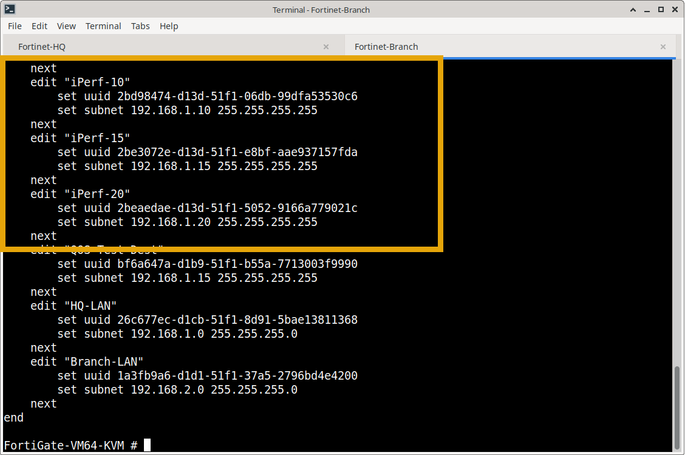

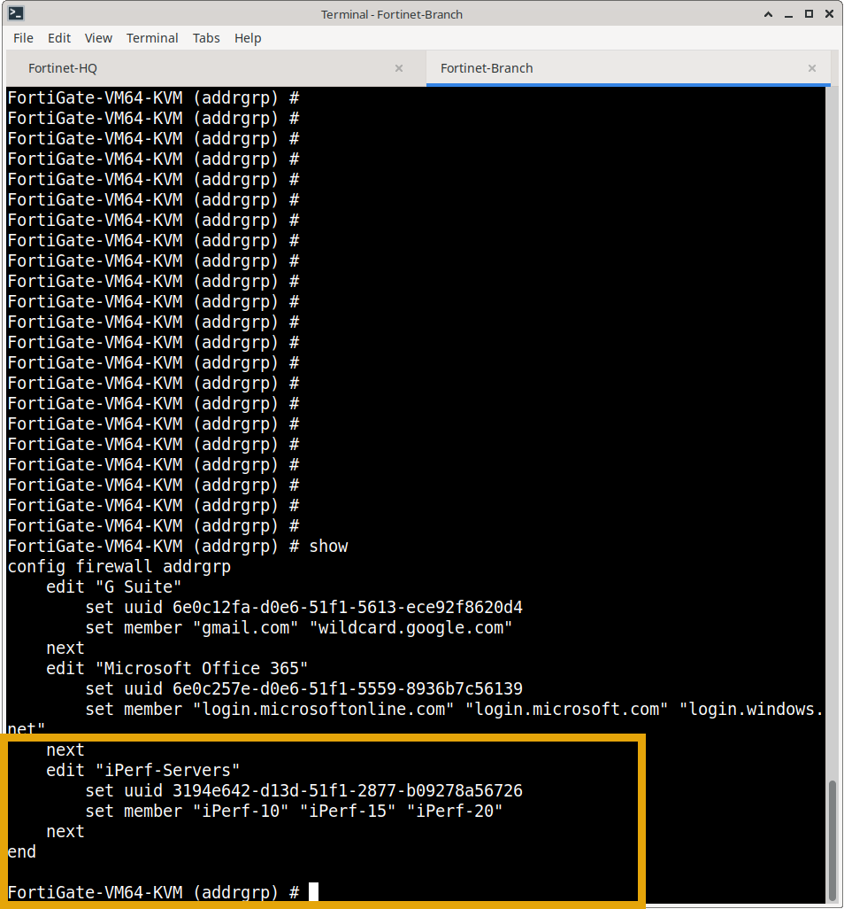

### 2. SLA Probe Target Configuration
Both members must satisfy explicit SLA health targets before being admitted into the active load-balancing pool:
```fortios
config system sdwan
    config health-check
        edit "ISP_A_Monitor"
            config sla
                edit 2
                    set latency-threshold 250
                    set jitter-threshold 50
                    set packetloss-threshold 5
                next
            end
        next
        edit "ISP_B_Monitor"
            config sla
                edit 2
                    set latency-threshold 250
                    set jitter-threshold 50
                    set packetloss-threshold 5
                next
            end
        next
    end
end
```
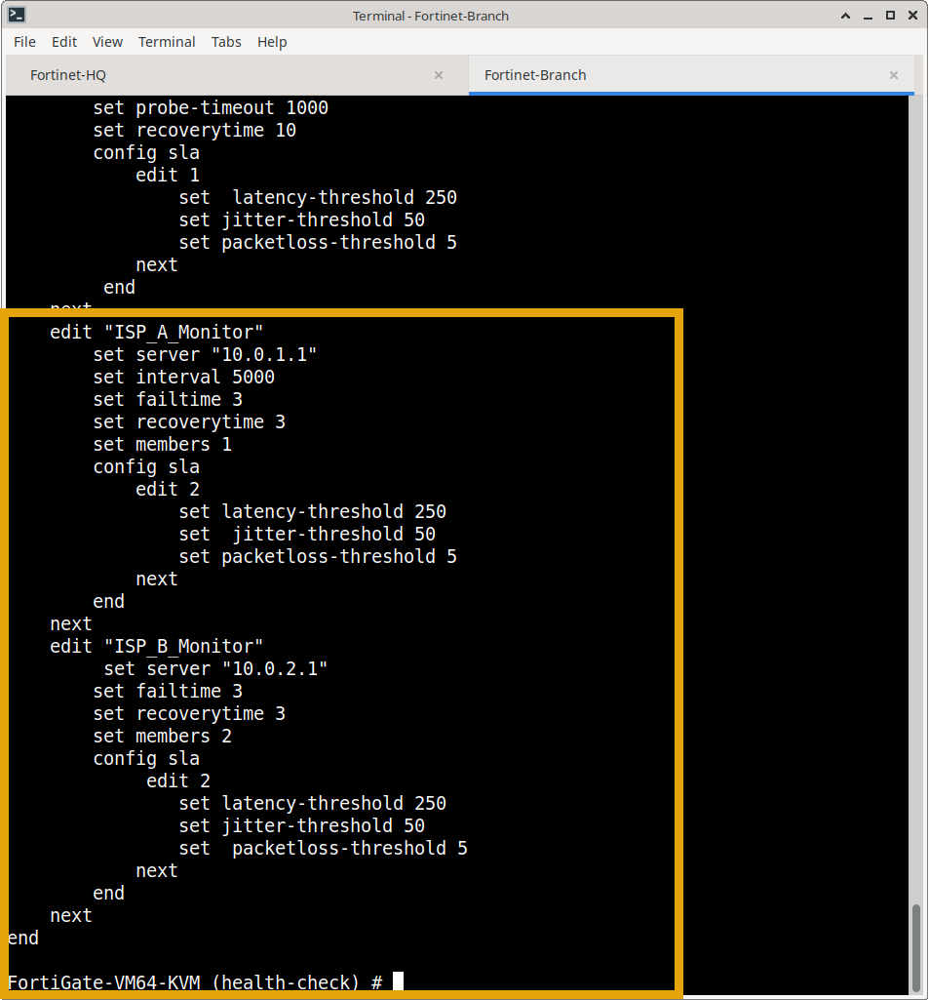

### 3. Active/Active SD-WAN Service Rule
```fortios
config system sdwan
    config service
        edit 3
            set name "Active-Active-iPerf"
            set mode load-balance
            set hash-mode source-dest-ip-based
            set dst "iPerf-Servers"
            config sla
                edit "ISP_A_Monitor"
                    set id 2
                next
                edit "ISP_B_Monitor"
                    set id 2
                next
            end
            set priority-members 1 2
        next
    end
end
```


---

## Step-by-Step Test Execution & Verification

### Phase 1: Baseline Single-Stream Verification (The "Pinning" Proof)
A high-bandwidth TCP iPerf3 stream was generated from `Branch Client 1` (`192.168.2.10`) targeting `HQ Server 1` (`192.168.1.10`). Packet captures were taken simultaneously on both physical WAN interfaces.

1. **Packet Capture on MPLS (`port2`):**
   * Filter: `ip.src == 192.168.2.10`
   * **Result:** **0 packets captured (0.0%)**. Confirms no traffic leaks onto the primary MPLS link.

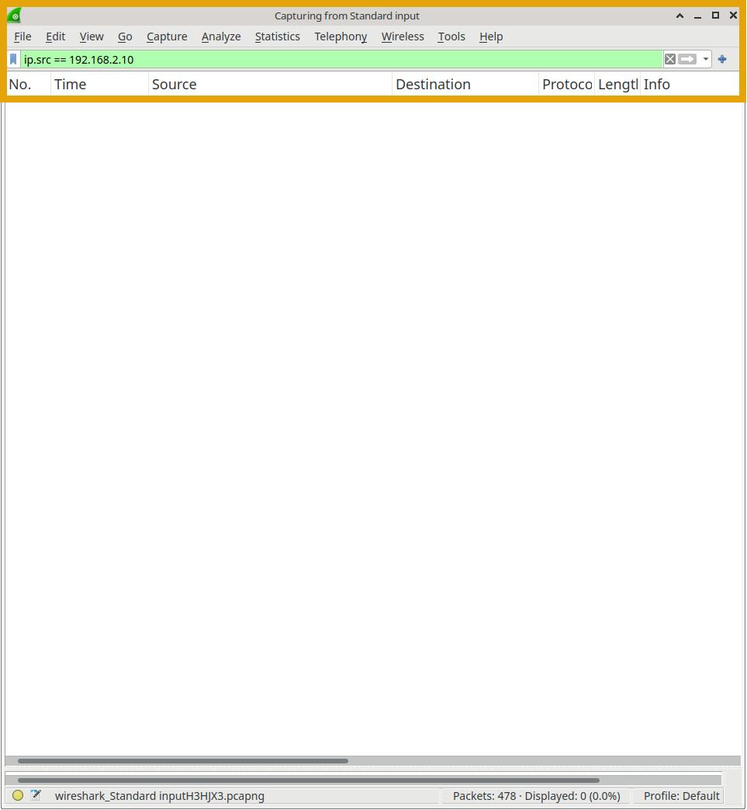


2. **Packet Capture on Broadband (`port3`):**
   * Filter: `ip.src == 192.168.2.10`
   * **Result:** **90,095 displayed out of 90,788 packets (99.2%)**. 
   * **Engineering Insight:** Confirms default flow pinning. A single flow will never be split across two physical links.

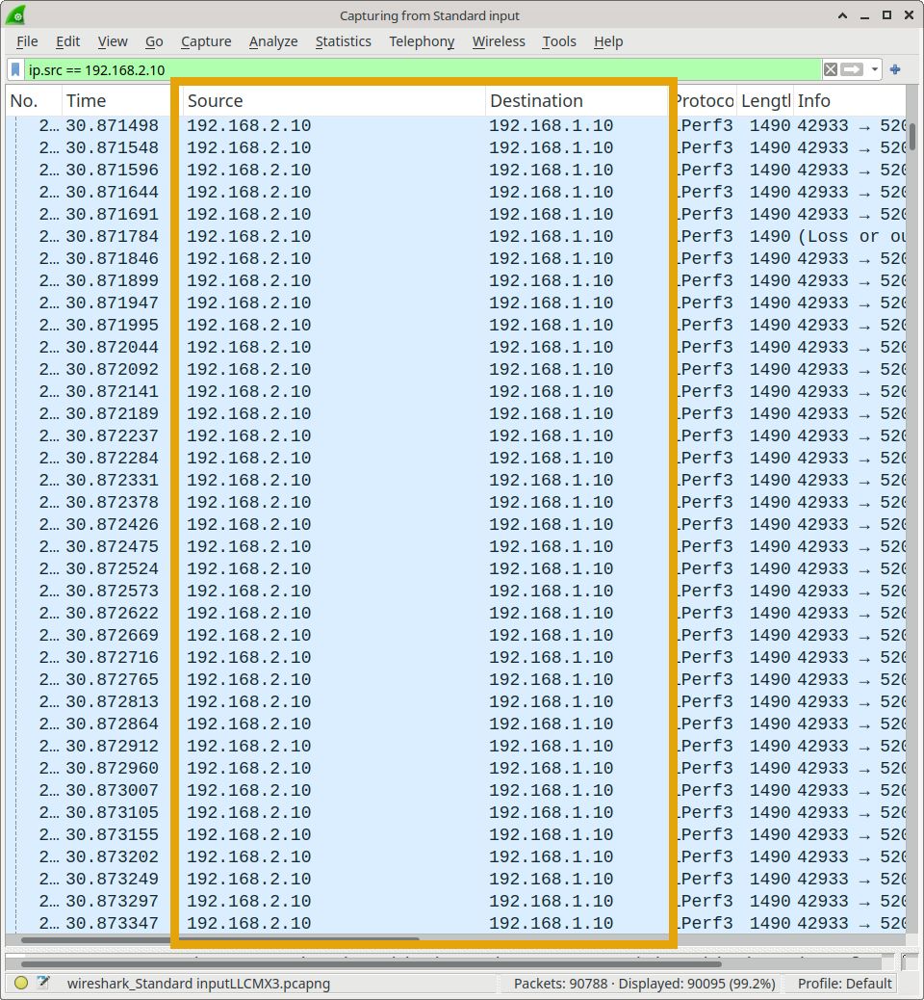

---

### Phase 2: Dual-Stream & Source-Destination IP Balancing
Secondary endpoints (`Branch PC 2` @ `192.168.2.15` and `HQ PC 2` @ `192.168.1.15`) were activated to create distinct IP pairs.

1. **HQ PC 2 iPerf3 Listener Initialization:**
   ```bash
   localhost:~# ip addr flush dev eth0
   localhost:~# ip addr add 192.168.1.15/24 dev eth0
   localhost:~# ip link set eth0 up
   localhost:~# ip route replace default via 192.168.1.1
   localhost:~# iperf3 -s
   -----------------------------------------------------------
   Server listening on 5201 (test #1)
   -----------------------------------------------------------
   ```
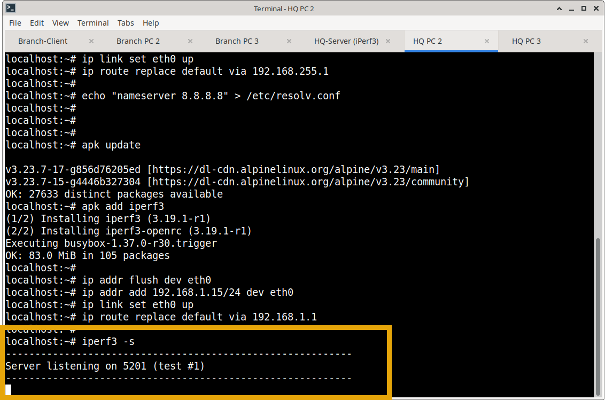

2. **Session Table Flush (Mandatory):**
   To flush existing stateful session entries bound to the previous rule evaluation:
   ```text
   FortiGate-VM64-KVM # diagnose sys session clear
   ```

3. **SD-WAN Service Diagnostic Output:**
   ```text
   FortiGate-VM64-KVM # diagnose sys sdwan service

   Service(3): Address Mode(IPV4) flags=0x200 use-shortcut-sla
   Gen(3), TOS(0x0/0x0), Protocol(0: 1->65535), Mode(load-balance  hash-mode=source-dest-ip-based)
   Members(2):
     1: Seq_num(2 port3), alive, sla(0x2), gid(2), num of pass(1), selected
     2: Seq_num(1 port2), alive, sla(0x0), gid(1), num of pass(0), selected
   Dst address(1):
           192.168.1.10-192.168.1.10
   ```
   Both Member 1 (`port2`) and Member 2 (`port3`) display `alive` and `selected`.

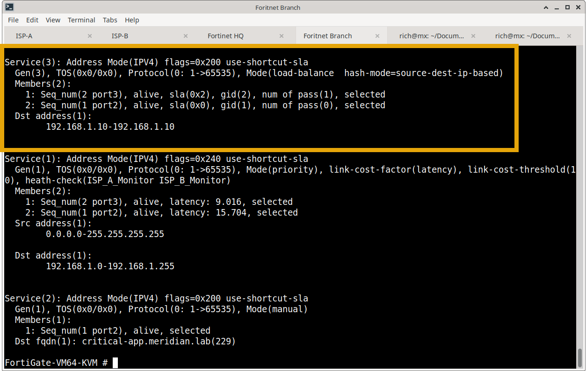

4. **Multi-Stream Execution:**
   * Stream 1 (`192.168.2.10` -> `192.168.1.10`): Evaluated to Hash Bucket A -> Routed across
    **`port3` (Broadband)**.
    
    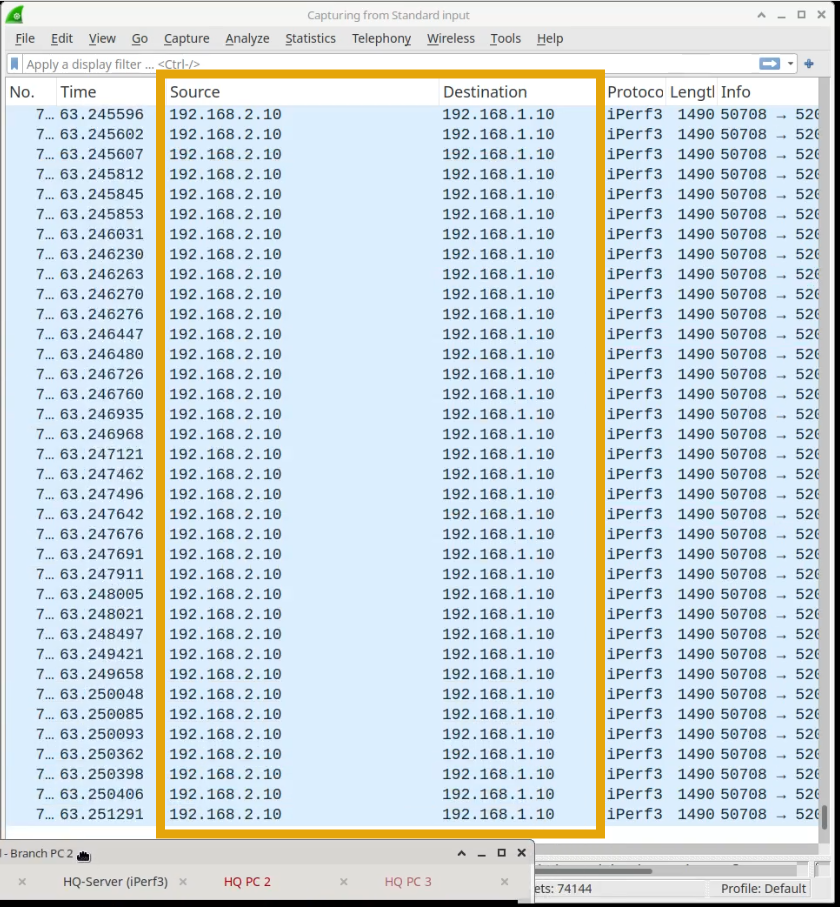
    
   * Stream 2 (`192.168.2.15` -> `192.168.1.15`): Evaluated to Hash Bucket B -> Routed across **`port2` (MPLS)**.
   
   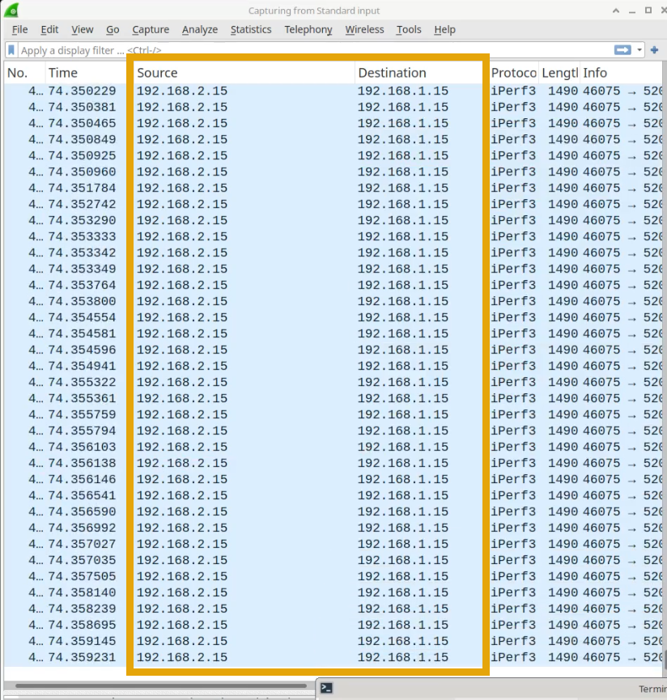
   
---

### Phase 3: Round-Robin Session Alternation
To achieve link balancing without requiring multiple unique client IPs, `hash-mode` was switched to `round-robin`:

```fortios
config system sdwan
    config service
        edit 3
            set hash-mode round-robin
        next
    end
end
```
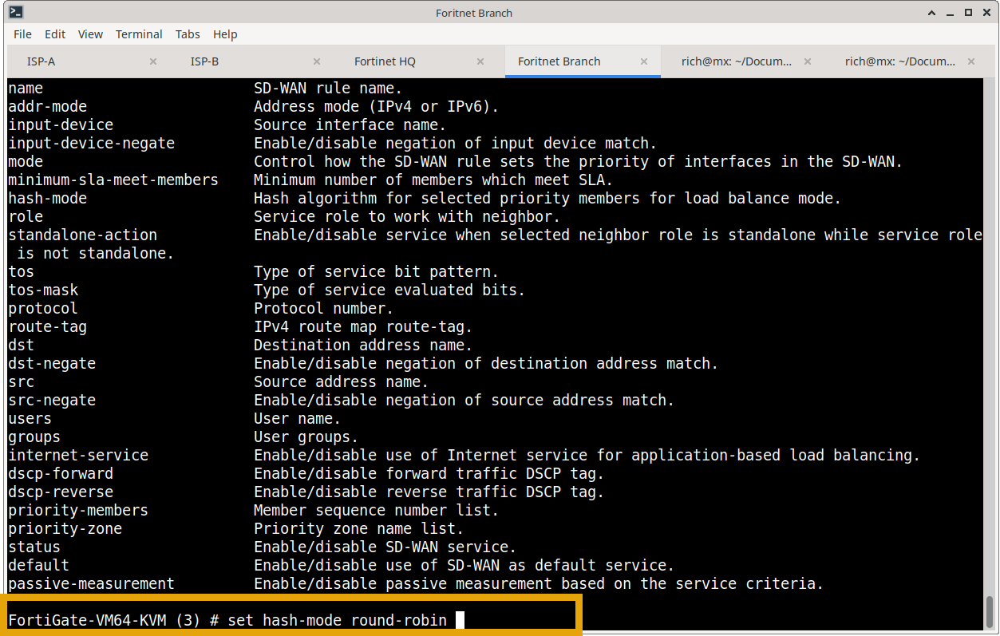

* **Observed Behavior:** Consecutive connections initiated from a single host (`Branch Client 1`) alternatingly selected `port2`, then `port3`, then `port2`.

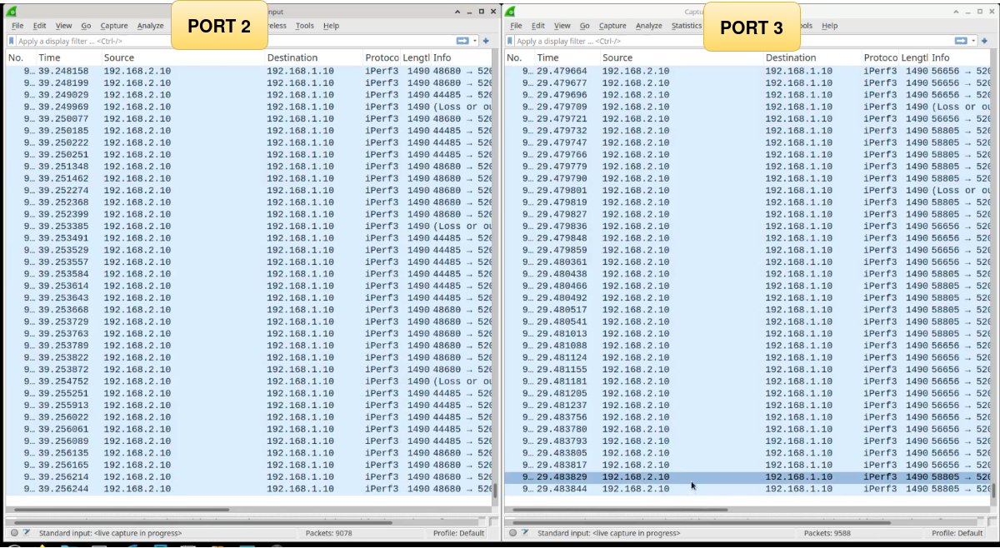

---

## Evidence Index

| Phase | Artifact / Screenshot | Purpose & Verification |
| :--- | :--- | :--- |
| **Phase 1: Baseline** | `3 stream test topology.png` | Network topology diagram showing multi-host testbed at HQ and Branch. |
| **Phase 1: Baseline** | `sh firewall address.png` | Confirms address object and address group configuration for iPerf server pool. |
| **Phase 1: Baseline** | `single-stream-pcap PORT 2 showing no traffic from branch node.png` | Wireshark capture on `port2` (MPLS) displaying 0 packets from `192.168.2.10`. |
| **Phase 1: Baseline** | `single stream pcap PORT 3 is the destination port .png` | Wireshark capture on `port3` (Broadband) displaying 90,095 packets (99.2%). |
| **Phase 1: Baseline** | `sd-wan-test-single-stream-source-dest-ip-2026-10-26_09.23.48.mp4` | Video recording proving single-stream hashing behavior and link pinning. |
| **Phase 2: Active/Active** | `show system sd wan.png` | Displays overall SD-WAN service inventory, health checks, and member lists. |
| **Phase 2: Active/Active** | `HQ deivce 2 listening for iperf.png` | Confirms secondary iPerf server (`192.168.1.15`) listening on port 5201. |
| **Phase 2: Active/Active** | `diagnose sys sd wan service.png` | Service table showing Rule 3 with both `port2` and `port3` simultaneously `selected`. |
| **Phase 2: Active/Active** | `get system sd wan .png` | Kernel verification of SD-WAN members, sequence IDs, and SLA compliance flags. |
| **Phase 2: Active/Active** | `sd-wan-test-double-stream-source-dest-ip-2026-10-26_09.29.25.mp4` | Live capture showing simultaneous throughput generation across both WAN links. |
| **Phase 3: Round-Robin** | `ROUND ROBIN TEST SINGLE STREAM CONFIGURATION ON FORTINET.png` | CLI configuration snippet applying `set hash-mode round-robin` under Rule 3. |
| **Phase 3: Round-Robin** | `sd-wan-test-round-robin-single-stream-2026-10-26_09.40.45.mp4` | Video evidence proving sequential sessions from the same host alternate across WAN paths. |

---

## Business Value Delivered
* **100% WAN Utilization:** Eliminates stranded bandwidth by turning passive, standby broadband lines into active production paths.
* **Aggregated Throughput:** Branches utilize the combined throughput of both connections, doubling file-transfer and backup speeds during peak operational hours.
* **TCP Protection by Design:** By balancing at the session level (via IP hashing) rather than per-packet, application performance is maximized without out-of-order packet drops or session instability.

---

### Next Module
* **[Task 4: SD-WAN Traffic Shaping & QoS Enforcement](../04-qos-traffic-shaping/)** — Implementing rate limiting, per-IP traffic shaping, and traffic priority queuing to protect critical applications from bandwidth starvation.
