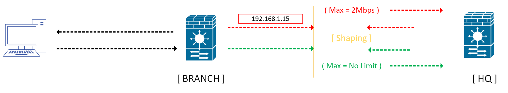
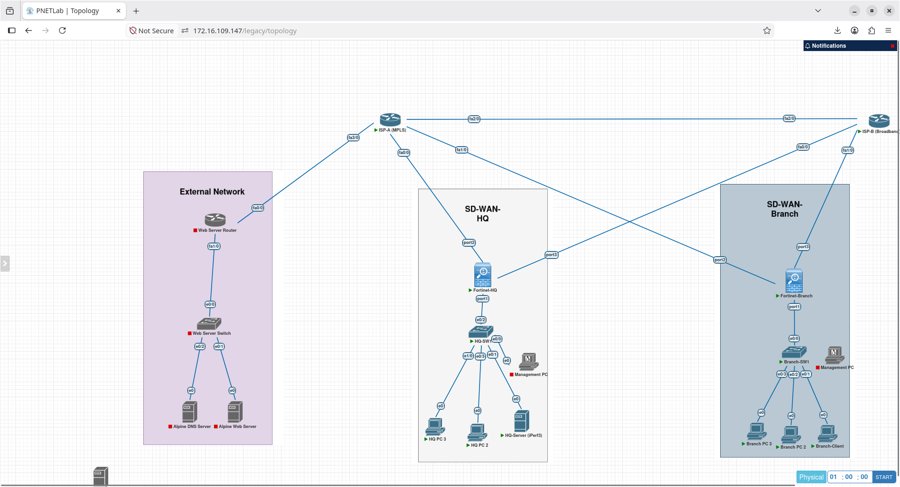
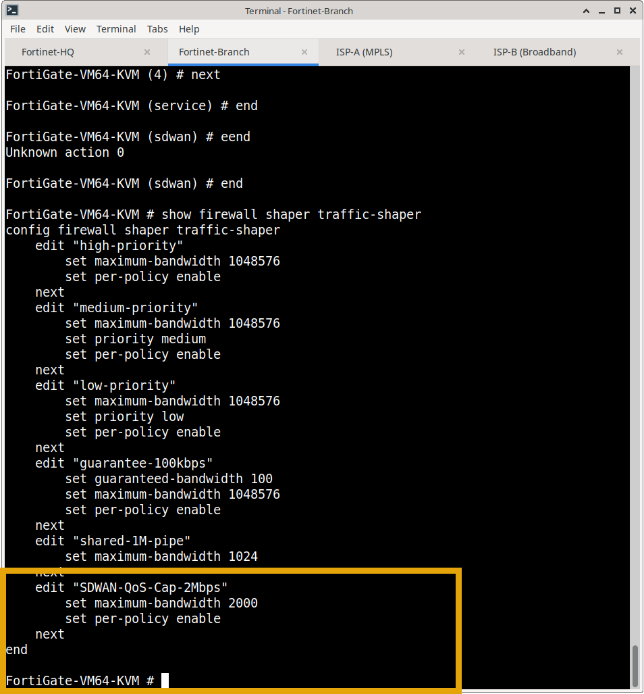
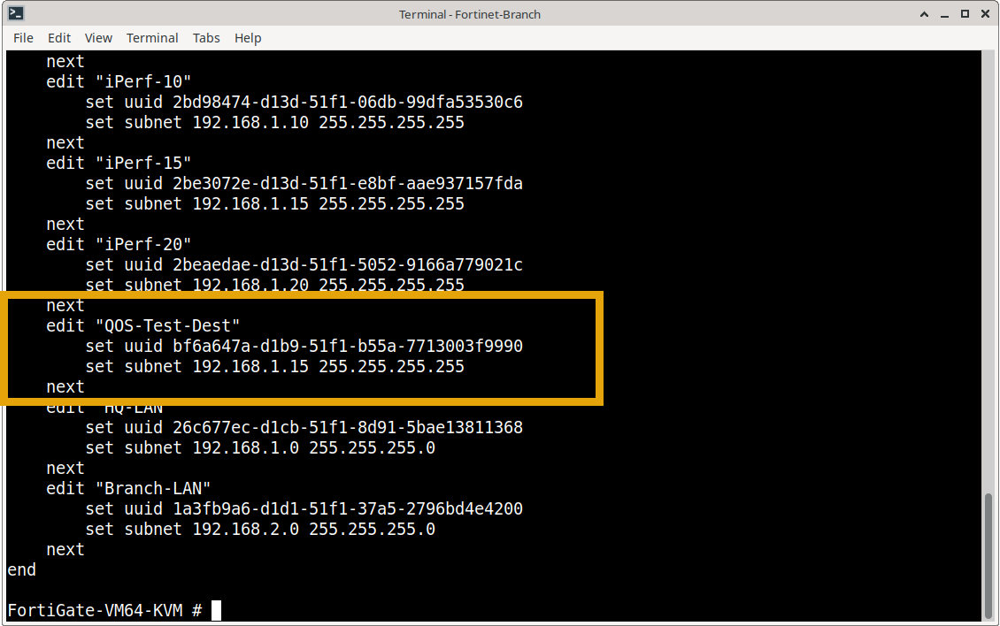
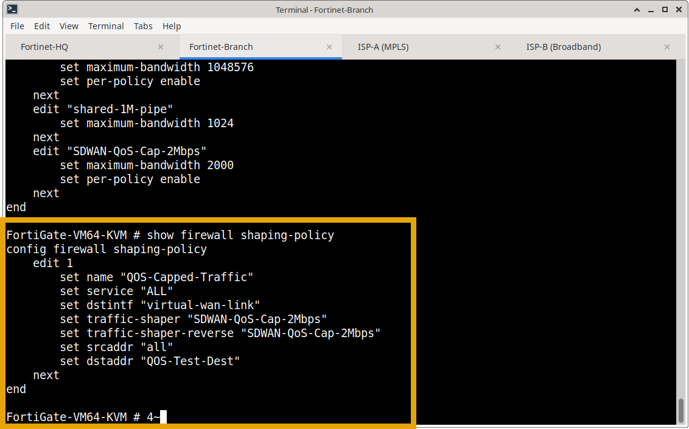
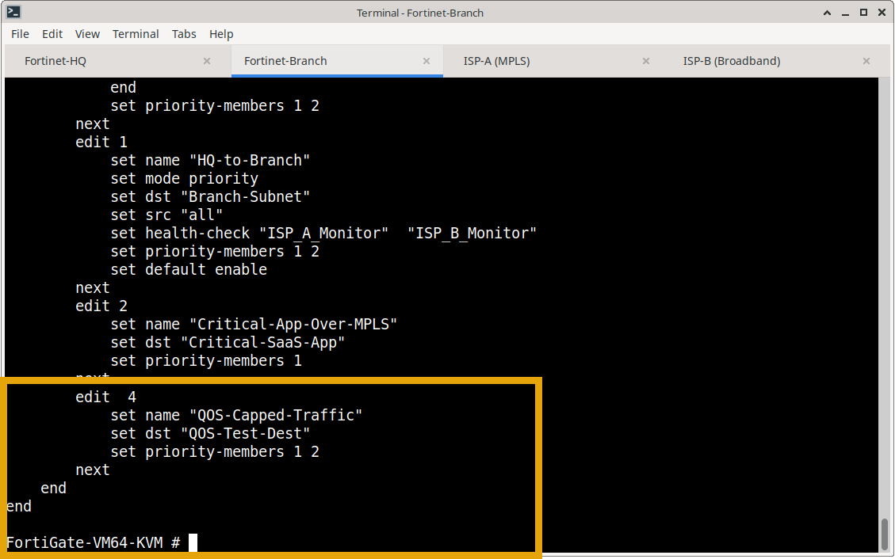
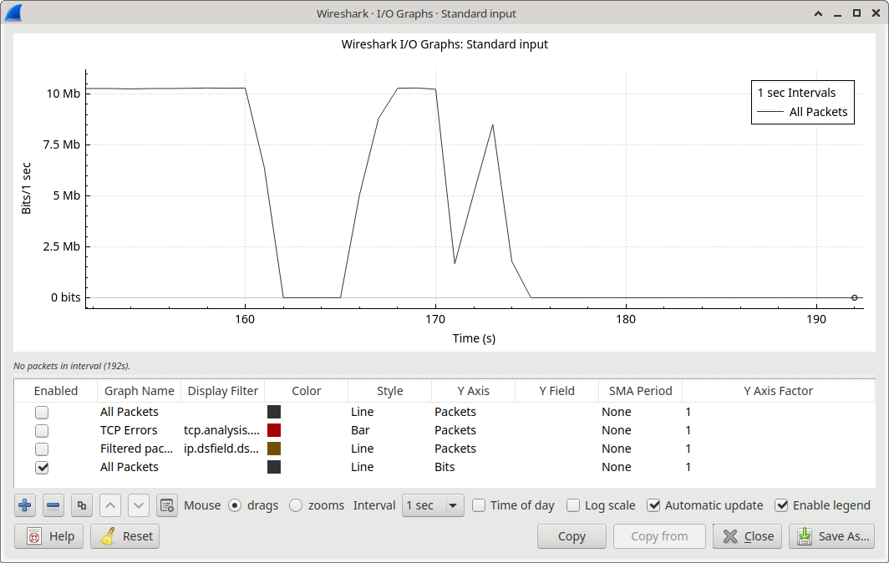
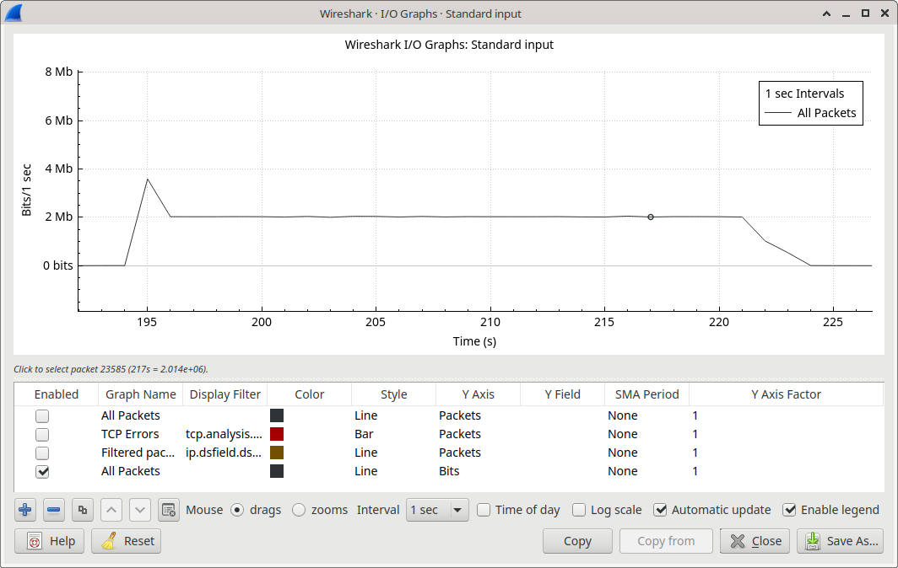
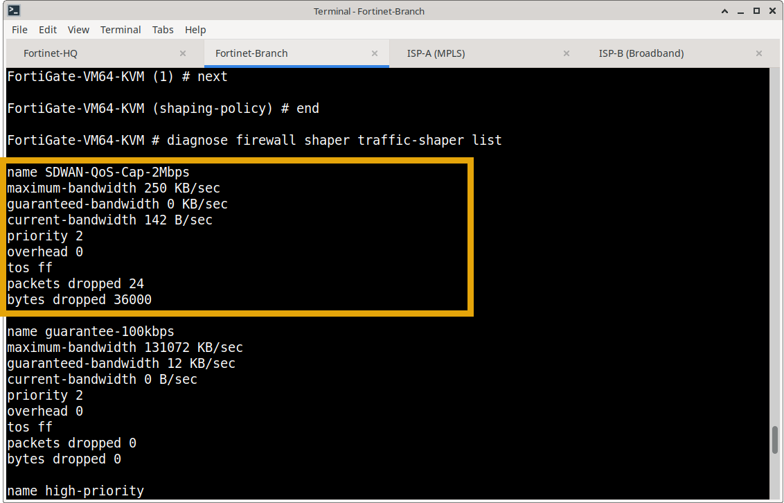

# 🚦 Task 4: SD-WAN Traffic Shaping & QoS Enforcement

## Executive Summary
While SD-WAN path selection determines **which** link traffic traverses (MPLS vs. Broadband), Traffic Shaping dictates **how much** bandwidth that traffic is allowed to consume. Without Quality of Service (QoS), a single bulk data transfer (e.g., an unthrottled database backup, FTP transfer, or software update) can saturate WAN links, inducing packet queuing, severe jitter, and dropped frames for latency-sensitive applications like VoIP and cloud ERP systems.

This module validates active **Quality of Service (QoS) Bandwidth Enforcement** integrated with the Fortinet SD-WAN architecture. A strict **2 Mbps (2000 Kbps)** rate-limiting shaper was deployed and enforced on outbound branch flows directed to bulk test targets (`192.168.1.15`). 

Using Wireshark I/O graphing, kernel shaper statistics, and stateful session table inspection, this module proves deterministic rate enforcement and token-bucket packet throttling at the network edge.

**Live QOS PCAP I/O Monitoring: Unshaped vs Shaped Traffic**

---

## Lab Architecture & Test Topology





### IP Addressing 
| Node | Interface | IP Address | Subnet Mask | Role / Description |
| :--- | :--- | :--- | :--- | :--- |
| **Branch FortiGate** | `port1` (LAN) | `192.168.2.1` | `255.255.255.0` | Enforcement Point (Shaper & SD-WAN Gateway) |
| **Branch FortiGate** | `port2` / `port3` | `10.0.1.6` / `10.0.2.6` | `255.255.255.252` | WAN Members in `virtual-wan-link` |
| **Branch Client** | `eth0` | `192.168.2.10` | `255.255.255.0` | Traffic Generator initiating 10 Mbps test stream |
| **HQ Server 2** | `eth0` | `192.168.1.15` | `255.255.255.0` | Target Server (`QoS-Test-Dest`) running iPerf3 (`:5201`) |

---

## Configuration & Engineering Design Logic

### 1. Architectural Separation of Concerns
In FortiOS, best-practice design decouples **traffic steering** from **bandwidth enforcement**:
* **Steering Domain (`config system sdwan`):** Selects which member interface (`port2` or `port3`) the session traverses based on health checks, SLA metrics, or administrator priority.
* **QoS Enforcement Domain (`config firewall shaping-policy`):** Evaluates ingress/egress interface tuples and address objects to attach bandwidth policers and token-bucket meters to the session flow.

### 2. Traffic Shaper Profile (`SDWAN-QoS-Cap-2Mbps`)
The profile enforces a hard rate ceiling of **2000 Kbps (250 KB/s)**. Setting `per-policy enable` ensures that this bandwidth pool is dedicated exclusively to matching policy flows.

```fortios
config firewall shaper traffic-shaper
    edit "SDWAN-QoS-Cap-2Mbps"
        set guaranteed-bandwidth 0
        set maximum-bandwidth 2000
        set bandwidth-unit kbps
        set priority high
        set per-policy enable
    next
end
```


### 3. Destination Address Object & Shaping Policy
The shaping policy intercepts flows destined for `QoS-Test-Dest` (`192.168.1.15/32`) egressing out the `virtual-wan-link` SD-WAN zone, attaching the shaper bidirectionally:

```fortios
config firewall address
    edit "QoS-Test-Dest"
        set subnet 192.168.1.15 255.255.255.255
    next
end

config firewall shaping-policy
    edit 1
        set name "QOS-Capped-Traffic"
        set service "ALL"
        set dstintf "virtual-wan-link"
        set traffic-shaper "SDWAN-QoS-Cap-2Mbps"
        set traffic-shaper-reverse "SDWAN-QoS-Cap-2Mbps"
        set srcaddr "all"
        set dstaddr "QoS-Test-Dest"
    next
end
```




### 4. SD-WAN Service Steering Rule 4
A dedicated SD-WAN service rule ensures that traffic targeting `QoS-Test-Dest` is tracked independently across members 1 and 2:

```fortios
config system sdwan
    config service
        edit 4
            set name "QOS-Capped-Traffic"
            set mode manual
            set dst "QOS-Test-Dest"
            set priority-members 1 2
        next
    end
end
```


---

## Verification & Execution Lifecycle

### Phase 1: Unthrottled Baseline Generation (No Shaper)
Before enforcing the policy, an iPerf3 stream of 10 Mbps was generated from `192.168.2.10` targeting `192.168.1.15`.
* **Observed Baseline:** The traffic unconstrained peaked and fluctuated between **8 Mbps and 10.2 Mbps**, consuming maximum underlay capacity and causing bufferbloat on intermediate links.



---

### Phase 2: Active Shaper Clamping & Throughput Flatline
The traffic shaping policy was committed, active sessions were cleared (`diagnose sys session clear`), and an iPerf3 test was initiated:
```bash
localhost:~# iperf3 -c 192.168.1.15 -u -b 10M -t 30 -p 5201
```

1. **Wireshark I/O Graph Verification:**
   * When the 10 Mbps burst hits the FortiGate, the rate spikes momentarily (~3.6 Mbps) as the initial token bucket empties.
   * Within **1 second**, the rate is clamped down and **flatlines at exactly 2.0 Mb/sec (2,000,000 bits/sec)** for the remainder of the test duration (seconds 197 through 222).
   * **Result:** Textbook rate-limiting plateau confirming zero bandwidth leakage beyond the configured threshold.



2. **Kernel Dropped-Packet Counters:**
   Inspecting the shaper daemon verified that packets exceeding the 250 KB/s ceiling were systematically dropped:
   ```text
   FortiGate-VM64-KVM # diagnose firewall shaper traffic-shaper list

   name SDWAN-QoS-Cap-2Mbps
   maximum-bandwidth 250 KB/sec
   guaranteed-bandwidth 0 KB/sec
   current-bandwidth 142 B/sec
   priority 2
   overhead 0
   tos ff
   packets dropped 24
   bytes dropped 36000
   ```
   * *24 packets (36,000 bytes) were dropped at the kernel queue level to enforce the rate limit.*



3. **Stateful Session Table Attachment:**
   Inspecting the FortiGate session table verified that the shaper profile was bound directly to the active connection flow:
   ```text
   FortiGate-VM64-KVM # diagnose sys session list

   session info: proto=17 proto_state=01 duration=9 expire=170 timeout=0 flags=00000000
   socketpair=00000000 socktype=0
   ...
   origin-shaper=SDWAN-QoS-Cap-2Mbps
   reply-shaper=SDWAN-QoS-Cap-2Mbps
   shaper: org_g=0/org_m=250000/org_b=0 rply_g=0/rply_m=250000/rply_b=0
   ```
   * *The parameters `org_m=250000` (Origin Maximum = 250,000 Bytes/sec = 2 Mbps) and `rply_m=250000` prove hardware/kernel-level flow enforcement.*

---

### Raw Packet Capture (PCAP) Download

For independent analysis in Wireshark, the raw packet capture trace corresponding to the I/O graphs and bandwidth throttling test is hosted in Google Drive:

📁 **[Open Google Drive QoS PCAP Directory](https://drive.google.com/drive/folders/1xNKku0h2z0-lYexh2hcQ3mCRdz?usp=sharing)**

| Artifact | Location | Size / Type | What It Validates |
| :--- | :--- | :--- | :--- |
| **`qos-pcap-proof.pcapng`** | [Google Drive Link](https://drive.google.com/drive/folders/1xNKku0h2z0-lYexh2hcQ3mCRdz?usp=sharing) | Raw Packet Capture (`.pcapng`) | Complete packet trace showing the transition from unconstrained 10 Mbps burst to a hard 2.0 Mbps rate-limited plateau. |

> **Wireshark Display Filter:** To isolate the test flow, apply:  
> `ip.addr == 192.168.1.15 && (tcp.port == 5201 || udp.port == 5201)`

---

## Evidence Index

| Phase | Artifact / Screenshot | Purpose & Verification |
| :--- | :--- | :--- |
| **Phase 1: Configuration** | `show-firewall-address.png` | Confirms destination address object `QoS-Test-Dest` (`192.168.1.15/32`). |
| **Phase 1: Configuration** | `show-traffic-shaper.png` | CLI output confirming `SDWAN-QoS-Cap-2Mbps` profile with `maximum-bandwidth 2000` (2 Mbps / 250 KB/s). |
| **Phase 1: Configuration** | `firewall-shaping-policy.png` | Firewall shaping policy explicitly binding the shaper to `virtual-wan-link` and `QoS-Test-Dest`. |
| **Phase 1: Configuration** | `sd-wan-service.png` | SD-WAN service configuration showing Rule 4 (`QOS-Capped-Traffic`) assigned to members 1 & 2. |
| **Phase 1: Configuration** | `diagnose sys sdwan service.png` | Active service table confirming Rule 4 is steering traffic destined for `192.168.1.15`. |
| **Phase 2: Baseline Execution** | `io-graph-no-shaping.png` | **Baseline Proof:** Wireshark I/O graph showing unthrottled traffic spiking up to ~10 Mbps without QoS. |
| **Phase 2: Bandwidth Clamping** | `io-graph-shaping.png` | **Crucial Proof:** Wireshark I/O graph showing the stream flatlining precisely at the 2.0 Mbps limit. |
| **Phase 3: Kernel Telemetry** | `traffic-shaper-dropped-packets.png` | Kernel output (`diagnose firewall shaper traffic-shaper list`) proving 24 packets (36,000 bytes) dropped to enforce the ceiling. |
| **Phase 3: Packet Evidence** | [Drive: `qos-pcap-proof.pcapng`](https://drive.google.com/drive/folders/1xNKku0h2z0-lYexh2hcQ3mCRdz?usp=sharing) | Full raw packet capture file containing all frames and timing data for the test. |
| **Phase 3: Live Verification** | `qos-shaping-test-2026-10-27_00.41.33.mp4` | Video recording of the live iPerf3 execution, Wireshark clamping, and stateful session inspection. |
| **Runbook** | `runbook` | Operational procedure containing diagnostic commands, session clearing, and filter definitions. |

---

## Business Value Delivered
* **Elimination of "Noisy Neighbors":** Prevents large data backups or bulk file downloads from hijacking the entire branch WAN connection.
* **Guaranteed Latency for Mission-Critical Apps:** Preserves headroom on both physical links so that VoIP, videoconferencing, and transactional SaaS remain jitter-free.
* **Deterministic SLA Delivery:** Guarantees consistent application performance during periods of severe link congestion without requiring expensive circuit bandwidth upgrades.

---

### Next Module
* **[Task 5: IPsec Overlay Tunnel over SD-WAN Zone](../05-ipsec-overlay-sdwan/)** — Encrypting and securing multi-path branch communications over public underlays using route-based IPsec VPN overlays with automated SD-WAN health monitoring.
