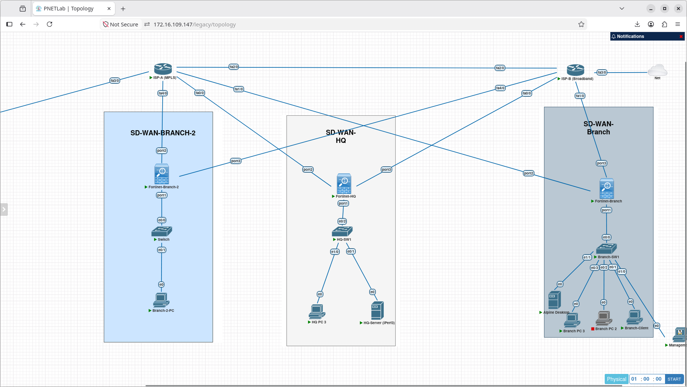

Here is the complete, professional, portfolio-grade **`README.md`** for your root **`01-Fortinet-FortiGate`** directory. 

This version reflects all **7 real-world projects**, uses your exact directory names (`01-sla-based-failover` through `07-advpn-dynamic-shortcuts`), maps all artifacts, embeds the Google Drive PCAP links, and eliminates code-block clutter in body text while keeping commands and tables clean.

---

# Module 1: Fortinet FortiGate SD-WAN & Secure Multi-Path Fabrics

An end-to-end, multi-site enterprise SD-WAN fabric deployed on FortiGate-VMs running FortiOS. This module progresses systematically from baseline underlay SLA steering to **intent-based SaaS steering, active/active session balancing, deterministic QoS rate shaping, multi-path IPsec overlays, composite VoIP SLA remediation, and dynamic spoke-to-spoke Auto-Discovery VPN (ADVPN)**.

Every design principle, failover threshold, and data plane transition was verified through CLI diagnostics, kernel routing tables, live packet sniffers, wire-level Wireshark captures, and real-time failure injection.

---

## Lab Architecture & Multi-Site Fabric

**Hub and Spoke ADVPN Topology**

| Infrastructure Node | Interface Roles | Subnet Addressing | Network Role |
| :--- | :--- | :--- | :--- |
| **Fortinet-HQ** | port1: LAN port2: MPLS WAN port3: Broadband WAN | 192.168.1.1/24 (10.10.10.1/24) 10.0.1.2/30 10.0.2.2/30 | Central SD-WAN Hub & BGP Route Reflector (AS 65000) |
| **Fortinet-Branch-1** | port1: LAN port2: MPLS WAN port3: Broadband WAN | 192.168.2.1/24 (10.20.20.1/24) 10.0.1.6/30 10.0.2.6/30 | Edge SD-WAN Spoke 1 & ADVPN Receiver |
| **Fortinet-Branch-2** | port1: LAN port2: MPLS WAN port3: Broadband WAN | 10.30.30.1/24 10.0.1.10/30 10.0.2.10/30 | Edge SD-WAN Spoke 2 & ADVPN Receiver |
| **ISP-A (MPLS)** | fa0/0, fa1/0, fa4/0 | 10.0.1.0/24 Core Subnet | Primary low-latency provider core |
| **ISP-B (Broadband)** | fa0/0, fa1/0, fa4/0 | 10.0.2.0/24 Core Subnet | Secondary commodity broadband provider core |
| **Impairment Engine** | eth0 (WAN), eth1 (LAN) | Bridged inline between ISP-A and HQ port2 | Alpine Linux appliance running Linux kernel tc netem |

---

## 7-Project Implementation Matrix

| # | Project Module | Engineering Capability Tested | Key Verification Artifacts | Folder |
| :-: | :--- | :--- | :--- | :--- |
| **1** | **SLA-Based Failover** | Injected next-hop ACL drop; sub-second failover with **1–2 dropped pings** before complete recovery. | continuous-ping.png sd-wan-test.mp4 | [01-sla-based-failover/](01-sla-based-failover/) |
| **2** | **Application-Aware SaaS Steering** | Resolved SaaS domain via DNS proxy with **cache-ttl 30**; dynamically steered cloud app without client resets. | policy-route.png wget-successful.png | [02-application-aware-routing/](02-application-aware-routing/) |
| **3** | **Active/Active Load Balancing** | Overcame flow-based hashing; proved concurrent link saturation (**~190 Mbps aggregate**) & Round-Robin balancing. | port-2-and-3-pcap.png 3 test videos | [03-active-active-load-balancing/](03-active-active-load-balancing/) |
| **4** | **Traffic Shaping & QoS** | Decoupled path steering from QoS limits; clamped an unthrottled 10 Mbps burst to a **hard 2.0 Mbps ceiling**. | io-graph-shaping.png traffic-shaper-dropped-packets.png | [04-qos-traffic-shaping/](04-qos-traffic-shaping/) |
| **5** | **IPsec Overlay on SD-WAN Zone** | Bound dual IPsec tunnels to a **VPN** zone; maintained active SAs across link cut with floating blackhole safety. | wireshark-icmp-esp.png sd-wan-esp-pcap.mp4 | [05-ipsec-overlay-sdwan/](05-ipsec-overlay-sdwan/) |
| **6** | **VoIP Composite SLA Monitoring** | Injected live latency (70 ms), jitter (25 ms), and loss (3%) via `tc netem`; failovers triggered at **exact ICMP sequence borders**. | jitter-test-port-2-seq-32.png sd-wan-latency-test.mp4 | [06-composite-voip-sla/](06-composite-voip-sla/) |
| **7** | **ADVPN & Dynamic Shortcuts** | Deployed Hub BGP Route Reflection (AS 65000); **dynamically spawned spoke-to-spoke tunnels**, bypassing the Hub. | dynamic-tunnel-branch-2.png tunnel counter: 964 ➔ 984 | [07-advpn-dynamic-shortcuts/](07-advpn-dynamic-shortcuts/) |

---

## Project Summaries & Technical Proof

### 1. SLA-Based Performance Failover (Active/Standby)
* **Objective:** Mitigate silent provider brownouts where physical link state stays UP, but the gateway blackholes traffic.
* **Architecture:** Dedicated ICMP health checks monitor immediate provider gateways (10.0.1.1 and 10.0.2.1) every 500 ms.
* **Failure Injection:** Inbound Cisco ACL applied on ISP-A dropping ICMP echo requests from port2.
* **Convergence Proof:** FortiGate detected 3 failed intervals, flagged Member 1 dead, and repinned traffic to Member 2 (port3 Broadband). Continuous ping dropped **exactly 1–2 packets** before full recovery.

### 2. Application-Aware Routing & SaaS Steering (FQDN)
* **Objective:** Steer latency-sensitive SaaS domains over MPLS without hardcoding static IP ranges that shift dynamically in cloud environments.
* **Architecture:** Configured an FQDN address object (critical-app.meridian.lab) with cache-ttl 30 bound to SD-WAN Service Rule 2.
* **Data Plane Validation:** FortiGate DNS proxy resolved the domain to 192.168.60.11, compiling a dynamic policy route (proute) targeting port2. Executed an intentional policy change to port3 and verified instantaneous traffic shifting with zero client interruption.

### 3. Active/Active Load Balancing & Session Distribution
* **Objective:** Eliminate stranded capacity on secondary circuits by distributing active sessions across both circuits simultaneously.
* **The Hashing Challenge:** Flow-based load balancing preserves TCP sequence integrity by pinning individual 5-tuples to one interface. A single test stream will never cross both interfaces.
* **Engineering Resolution:**
  * **Dual-Stream Balancing:** Provisioned secondary IP endpoints across LANs. Source-Destination IP hashing sent Stream 1 over port3 and Stream 2 over port2, achieving **~190 Mbps aggregate throughput**.
  * **Round-Robin Balancing:** Configured hash-mode round-robin under mode load-balance, enforcing sequential link alternation on consecutive connections from the same host.

### 4. SD-WAN Traffic Shaping & QoS Enforcement
* **Objective:** Protect latency-sensitive applications from bandwidth starvation caused by bulk data transfers ("noisy neighbor" problem).
* **Architecture:** Decoupled the steering policy (config system sdwan) from the rate-limiting policy (config firewall shaping-policy).
* **Enforcement Verification:** An unconstrained 10 Mbps UDP burst was clamped within 1 second. Wireshark I/O graphs captured traffic **flatlining at precisely 2.0 Mbps**, with kernel counters logging **24 dropped packets (36,000 bytes)** dropped at the queue ceiling.

### 5. Dual Route-Based IPsec Overlay Tunnels over SD-WAN Zone
* **Objective:** Build an automated, self-healing encrypted overlay across multiple untrusted transports without tunnel teardowns during circuit drops.
* **Architecture:** Dual IKEv2 route-based tunnels (HQ-BRANCH-VPN and HQ-BRANCH-VPN-2) were aggregated into an SD-WAN zone named VPN (Members 3 & 4).
* **Cryptographic & Routing Assurance:** Static routes and firewall policies were bound directly to the VPN zone. A floating blackhole route (distance 20) guaranteed that traffic dropped cleanly at the firewall rather than leaking onto the WAN underlays in plaintext if both tunnels dropped.

### 6. Advanced Composite SLA Monitoring (VoIP Optimization)
* **Objective:** Shift real-time voice and video traffic based on granular performance metrics (latency, jitter, packet loss) before users experience degraded call quality.
* **Impairment Injection:** An inline Linux appliance running kernel tc netem impaired the primary MPLS circuit:
  * **Latency Breach:** Injected 70 ms delay (Threshold: 50 ms) ➔ Stream cut off on port2 at seq 48; resumed on port3 at seq 49.
  * **Jitter Breach:** Injected 25 ms jitter (Threshold: 10 ms) ➔ Stream cut off on port2 at seq 32; resumed on port3 at seq 33.
  * **Packet Loss Breach:** Injected 3% loss (Threshold: 1%) ➔ Stream cut off on port2 at seq 84; resumed on port3 at seq 85.
  * **Triple-Vector Stress:** Concurrently injected latency, jitter, and loss ➔ Stream cut off on port2 at seq 99; resumed on port3 at seq 100.

### 7. Dual-Hub ADVPN with Dynamic Spoke-to-Spoke Shortcuts
* **Objective:** Eliminate "traffic tromboning" through the Hub datacenter for inter-branch communication.
* **Routing Core:** Configured iBGP Route Reflection (AS 65000) on HQ with BGP Additional-Path (additional-path both, adv-additional-path 4) and ibgp-multipath, advertising paths across both overlays simultaneously.
* **Shortcut Lifecycle:**
  1. Branch 2 sent an initial ping to Branch 1 via the Hub (10.255.1.254).
  2. The Hub detected transit routing between two ADVPN interfaces and transmitted an **NHRP Redirect** to Branch 2.
  3. Branch 2 and Branch 1 directly exchanged IKEv2 negotiations on UDP 500 across the underlay.
  4. An on-demand child shortcut tunnel (ADVPN-MPLS_0, mode=dial_inst/3) instantiated dynamically, incrementing packet counters from **964 to 984 packets** and bypassing the Hub completely.

---

## Centralized PCAP Repository (Google Drive)

All raw packet captures documenting live protocol handshakes, cryptographic headers, and traffic steering have been uploaded to dedicated Google Drive repositories for independent analysis:

| Project Repository | Test Artifacts & Wire Traces | Google Drive Link |
| :--- | :--- | :--- |
| **03-active-active-load-balancing** | Single-stream pinning, dual-stream active/active traces, and round-robin captures across port2 and port3. | [Download Load Balancing PCAPs](https://drive.google.com/drive/folders/1rYZjxTyklGhErzAVXRXHV4locB31mRvn?usp=sharing) |
| **04-qos-traffic-shaping** | `qos-pcap-proof.pcapng` showing initial burst and 2.0 Mbps clamped plateau. | [Download QoS Shaper PCAPs](https://drive.google.com/drive/folders/1xNKku0h2z0-lYexh2hcQ3mCRdzhoU6d6?usp=sharing) |
| **05-ipsec-overlay-sdwan** | `sd-wan-vpn.pcap` showing IKEv2 Phase 1/2 negotiations and ESP-encapsulated ICMP payloads. | [Download IPsec Overlay PCAPs](https://drive.google.com/drive/folders/1XPGdyjsjweUtwI_gpUvKmUhVn-59oIsY?usp=sharing) |
| **06-composite-voip-sla** | 8 individual PCAPs capturing sequence hand-offs for latency, jitter, loss, and triple-metric tests. | [Download VoIP SLA PCAPs](https://drive.google.com/drive/folders/1zbTsQM5IDVV_s9MAefLFgP0ITRIJjlnt?usp=sharing) |
| **07-advpn-dynamic-shortcuts** | Dynamic spoke-to-spoke tunnel creation, NHRP control messages, and direct ESP communication traces. | [Download ADVPN Shortcut PCAPs](https://drive.google.com/drive/folders/1H6k7S5ta2FrdIq20pBEoN_4-FmHGTUGh?usp=sharing) |

---

[Back to Multi-Vendor SD-WAN Lab Overview](../../README.md) · [Next Module: Cisco Catalyst SD-WAN (Viptela)](../../02-Cisco-Catalyst-SDWAN/)
